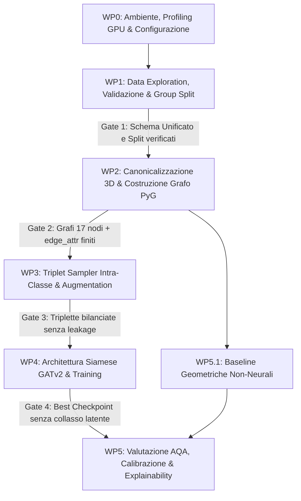

# Sottospecifica Operativa: Decomposizione in Task, Modalità Implementative ("Come") e Vincoli ("Constraint")

**Progetto:** Siamese GATv2 per Action Quality Assessment (AQA) nel Pattinaggio di Figura  
**Documento padre:** [specifica_implementativa_gnn_pattinaggio.md](file:///c:/MAGISTRALE/DeepLearningBigData/Pose%20Landmark/specifica_implementativa_gnn_pattinaggio.md)  
**Riferimento critico:** [Revisione critica progetto GNN sportivo.pdf](file:///c:/MAGISTRALE/DeepLearningBigData/Pose%20Landmark/Revisione%20critica%20progetto%20GNN%20sportivo.pdf)  
**Orizzonte temporale:** 14 giorni (MVP accademico — *Big Data and Deep Learning*)

---

## 1. Analisi Architetturale della Specifica Madre

L'analisi incrociata della specifica implementativa e della revisione critica evidenzia che il successo del progetto (e la sua difendibilità in sede d'esame) non dipende dalla complessità dell'architettura neurale, bensì dal rispetto di **6 vincoli strutturali bloccanti (Gating Constraints)**:

1. **Validazione empirica del dato sorgente prima del codice di modello:** I file `.npz` di FineFS e le annotazioni GOE non vanno mai assunti a scatola chiusa. Prima di costruire i grafi occorre dimostrare che le coordinate sono realmente 3D, identificare il sistema di riferimento $(X, Y, Z)$, mappare l'ordine esatto dei 17 joint e verificare che il GOE sia associato al singolo sotto-elemento tecnico e non solo all'intero programma.
2. **Prevenzione rigorosa del Data Leakage tramite Group Split:** Frame adiacenti o ripetizioni dello stesso elemento nella medesima esibizione/atleta hanno correlazione spaziale altissima. Lo split `train / val / test` deve avvenire a livello di **esibizione e atleta** *prima* di qualsiasi operazione di data augmentation, calcolo di prototipi di riferimento o calibrazione.
3. **Ordine matematico tra Canonicalizzazione 3D e Media Temporale:** Nelle piroette (*Spins*) del pattinaggio di figura l'atleta ruota attorno all'asse verticale. Se si calcolasse la media delle coordinate $\bar{P} = \frac{1}{T}\sum_t P_t$ *prima* dello **Yaw Alignment**, la rotazione continua farebbe collassare gli arti verso l'asse di rotazione per cancellazione vettoriale. Ogni singolo frame $t$ deve quindi essere centrato, scalato e ruotato nel sistema canonico **prima** di eseguire l'aggregazione temporale $\bar{P}$.
4. **Giustificazione della GNN contro il "Paradosso della Sottrazione":** Poiché i 17 nodi dello scheletro sono già indicizzati e semanticamente corrispondenti tra due grafi ($G_A$ e $G_B$), l'uso di una Siamese GATv2 è giustificato solo se apprende una metrica non-lineare pesata biomeccanicamente (catturando le compensazioni posturali lungo la catena cinematica) che supera empiricamente una semplice **baseline trigonometrica/euclidea non-neurale**.
5. **Coerenza semantica delle Triplette (Intra-Classe):** La Triplet Loss deve confrontare $(G_{\text{Anchor}}, G_{\text{Positive}}, G_{\text{Negative}})$ appartenenti **allo stesso elemento tecnico** (es. tutti e tre *Camel Spin*). Mescolare elementi diversi trasformerebbe silenziosamente il task di *Action Quality Assessment* in *Action Recognition*.
6. **Isolamento del Domain Shift in Inferenza (HRNet vs MediaPipe):** Il modello addestrato sui 17 keypoint 3D HRNet di FineFS non può ricevere direttamente i 33 landmark di MediaPipe senza un operatore di proiezione topologica $P: \mathbb{R}^{33 \times 3} \to \mathbb{R}^{17 \times 3}$ e una verifica di allineamento distributivo (*Keypoint-level Domain Alignment*).

### 1.1 Mappa delle Sottospecifiche (Work Packages) e Dipendenze



---

## 2. WP0 — Setup Ambiente, Profiling Hardware e Configurazione Base

### Task 0.1 — Profiling Hardware (GPU/VRAM/CUDA) e Pinning Dipendenze
- **File target:** `requirements.txt`, `src/utils/env_check.py`
- **Obiettivo:** Rilevare le capacità reali della macchina (Asus Vivobook Pro 15 con Ryzen 6000 e GPU NVIDIA Mobile) e garantire l'operatività di PyTorch e PyTorch Geometric (PyG) sia su GPU a bassa VRAM (4–6 GB) sia in fallback CPU.
- **Come (Modalità implementativa):**
  1. Scrivere uno script `src/utils/env_check.py` che interroga `torch.cuda.is_available()`, `torch.cuda.get_device_name(0)` e `torch.cuda.get_device_properties(0).total_memory`.
  2. Verificare l'installazione di `torch`, `torch_geometric` e la compatibilità del metodo `GATv2Conv(..., edge_dim=..., return_attention_weights=True)` istanziando un grafo sintetico a 17 nodi e 32 archi ed eseguendo un passo forward + backward di test.
  3. Fissare le versioni esatte in `requirements.txt` (`numpy`, `scipy`, `torch`, `torch-geometric`, `scikit-learn`, `matplotlib`, `pyyaml`, `pytest`).
- **Constraint (Vincoli):**
  - **VRAM Budget:** Il picco di memoria allocata durante il training (`torch.cuda.max_memory_allocated()`) non deve superare **1.0 GB** per consentire l'esecuzione stabile anche su schede RTX 3050 Mobile da 4 GB.
  - **CPU Fallback:** Nessun modulo deve contenere chiamate `.cuda()` cablate; il device (`cuda` o `cpu`) deve essere passato dinamicamente tramite oggetto `torch.device`.
  - **Offline Execution:** L'addestramento non deve mai decodificare file video `.mp4`/`.avi` in memoria GPU.

### Task 0.2 — Configurazione Dichiarativa e Riproducibilità Deterministica
- **File target:** `configs/data.yaml`, `configs/graph.yaml`, `configs/training.yaml`, `src/utils/seed.py`
- **Obiettivo:** Centralizzare tutti gli iperparametri, le convenzioni anatomiche e i seed casuali in file YAML versionati.
- **Come (Modalità implementativa):**
  1. Implementare `set_global_seed(seed: int = 42)` che fissa `random.seed`, `np.random.seed`, `torch.manual_seed`, `torch.cuda.manual_seed_all` e imposta `torch.backends.cudnn.deterministic = True`.
  2. Creare `configs/data.yaml` (percorsi dataset, elementi tecnici selezionati, percentuali split, numero frame finestra $T$, soglia $\epsilon = 10^{-6}$).
  3. Creare `configs/graph.yaml` (mappa semantica dei 17 joint, lista delle coppie di archi anatomici $E$, lista delle terne articolari $(i, j, k)$ associate a ciascun arco per il calcolo di $\cos\theta_{ijk}$).
  4. Creare `configs/training.yaml` (dimensioni hidden/embedding $d \in \{32, 64\}$, `heads: 4`, `dropout`, learning rate, weight decay, strategia di margine fisso/adattivo e soglie GOE).
- **Constraint (Vincoli):**
  - **Divieto di Magic Numbers:** È vietato inserire indici di joint (es. `11`, `12`, `5`, `6`), soglie GOE o valori di margine $\alpha$ direttamente dentro i file Python di `src/models/` o `src/training/`. Tutto deve essere letto dai file YAML.

---

## 3. WP1 — Sottospecifica Dati: Esplorazione, Validazione, Armonizzazione e Split (Giorni 1–3)

### Task 1.1 — Ispezione Strutturale e Validazione di FineFS
- **File target:** `notebooks/01_dataset_exploration.ipynb`, `src/data/loaders.py`, `reports/data_audit_finefs.md`
- **Obiettivo:** Ispezionare il contenuto reale dei file `.npz` e dei file di annotazione di FineFS per verificare le ipotesi progettuali prima di scrivere il codice di preprocessing.
- **Come (Modalità implementativa):**
  1. Caricare un campione rappresentativo di file `.npz` con `np.load(..., allow_pickle=True)` ed elencare tutte le chiavi (`files`), i `dtype` e le `shape` degli array contenuti.
  2. Verificare che le coordinate dei keypoint abbiano shape riconducibile a $(T_{\text{tot}}, 17, 3)$ (oppure $(T_{\text{tot}}, 17, 4)$ se il quarto canale è la confidenza).
  3. Plottare in 3D (proiezioni sui piani $XY$, $XZ$, $YZ$) uno scheletro in posa eretta per identificare empiricamente:
     - L'indice esatto di ciascuno dei 17 joint (verificando la corrispondenza con lo standard COCO/Human3.6M usato da HRNet: pelvi/anche, spalle, gomiti, polsi, ginocchia, caviglie, testa/naso).
     - Il verso e il significato fisico degli assi $X$, $Y$ e $Z$ (es. quale asse rappresenta la verticale gravitazionale contro cui ruotare lo Yaw).
  4. Analizzare i file JSON/CSV delle annotazioni per ricostruire la chiave di join tra file scheletro, intervallo temporale `[start_frame, end_frame]`, classe dell'elemento tecnico (`element_label`) e punteggio `goe`.
  5. Quantificare la percentuale di frame con valori `NaN`, `Inf`, scheletri interamente nulli (`np.allclose(kp, 0)`) o segmenti con durata $T_{\text{seg}} < 5$ frame.
- **Constraint (Vincoli — GATING CRITICO):**
  - **Blocco del progetto in caso di mancato allineamento:** Non è consentito procedere al Task 1.4 o al WP2 finché non è documentata nel report `reports/data_audit_finefs.md` la mappa esatta `{indice_0_16: nome_anatomico}` e l'asse verticale effettivo del sistema di riferimento 3D.
  - **Verifica granularità GOE:** Se in alcuni record il GOE fosse riportato solo a livello di intera performance e non di singolo elemento segmentato, tali record devono essere filtrati ed esclusi dal training.

### Task 1.2 — Protocollo di Verifica Compatibilità ed Eventuale Esclusione di MMFS
- **File target:** `src/data/harmonization.py`
- **Obiettivo:** Stabilire oggettivamente se il dataset integrativo MMFS può essere unito a FineFS o se deve essere scartato per evitare *domain shift* artificiale.
- **Come (Modalità implementativa):**
  1. Eseguire una checklist di compatibilità a 8 punti su MMFS rispetto a FineFS:
     - Ordine e semantica dei 17 joint;
     - Dimensionalità (2D vs 3D) e sistema di coordinate;
     - Pose estimator impiegato (HRNet) e formato di output;
     - Unità di misura e proporzioni medie delle lunghezze ossee post-normalizzazione;
     - Definizione temporale dei segmenti;
     - Scala e semantica del punteggio GOE;
     - Presenza di identificativi esibizione/atleta;
     - Controllo di sovrapposizione (stesse gare/video presenti sia in FineFS che in MMFS).
- **Constraint (Vincoli):**
  - **Divieto di concatenazione cieca:** È severamente vietato unire i campioni di MMFS a FineFS solo perché entrambi presentano tensori di dimensione $17 \times 3$.
  - **Regola di esclusione (Fail-Safe):** Se MMFS presenta coordinate solo 2D, una topologia dei 17 joint incompatibile, una scala GOE non allineabile o il rischio di duplicare esibizioni già presenti in FineFS (causando leakage tra train e test), **MMFS deve essere escluso dall'MVP** (cfr. §3.2 e §17 della specifica madre).

### Task 1.3 — Selezione Data-Driven degli Elementi Tecnici Target
- **File target:** `src/data/segmentation.py`, `configs/data.yaml`
- **Obiettivo:** Selezionare da 1 a 3 elementi tecnici del pattinaggio dotati di una fase di tenuta stabile (es. *Camel Spin*, *Sit Spin*, *Layback Spin*) e con copertura statistica sufficiente.
- **Come (Modalità implementativa):**
  1. Calcolare per ogni classe di elemento presente in FineFS:
     - Numero totale di istanze valide $N_c$;
     - Numero di esibizioni/atleti distinti;
     - Distribuzione empirica del GOE (media, mediana, percentili $25^\circ$ e $75^\circ$, conteggio campioni con $\text{GOE} \ge \tau_{\text{pos}}$ e $\text{GOE} \le \tau_{\text{neg}}$);
     - Durata media in frame del segmento $(\text{end\_frame} - \text{start\_frame})$.
  2. Selezionare le classi (da 1 a 3) che massimizzano la numerosità e garantiscono la presenza sia di esecuzioni eccellenti (Anchor/Positive) sia di esecuzioni sub-ottimali (Negative).
- **Constraint (Vincoli):**
  - Non selezionare salti multi-rotazione rapidissimi se il campionamento temporale non consente di isolare una fase riproducibile; dare priorità assoluta alle **Spins (piroette)** o **Spirals** dove la posa canonica è mantenuta per più frame consecutivi.

### Task 1.4 — Costruzione dello Schema Dati Unificato (`UnifiedSample`)
- **File target:** `src/data/harmonization.py`, `data/intermediate/unified_manifest.jsonl`
- **Obiettivo:** Incapsulare ogni segmento valido nello schema standardizzato previsto dalla §3.4 della specifica madre.
- **Come (Modalità implementativa):**
  1. Definire una `dataclass` (o modello Pydantic/TypedDict) `UnifiedSample` con i campi obbligatori:
     - `sample_id: str` (es. `"finefs_perf0142_elem03"`)
     - `dataset_id: str` (`"finefs"` o `"mmfs"`)
     - `performance_id: str`
     - `athlete_id: Optional[str]`
     - `element_label: str`
     - `start_frame: int`
     - `end_frame: int`
     - `keypoints: np.ndarray` di shape `(T_seg, 17, 3)` in `float32`
     - `keypoint_confidence: Optional[np.ndarray]` di shape `(T_seg, 17)`
     - `goe: float`
     - `source_metadata: dict` (file `.npz` sorgente, indice annotazione originale, flag di validità).
  2. Salvare l'indice completo in `data/intermediate/` mantenendo il registro dei campioni scartati con il relativo motivo (`missing_goe`, `corrupted_keypoints`, `too_short`).
- **Constraint (Vincoli):**
  - **Tracciabilità reversibile:** Dato qualsiasi `sample_id` in fase di test o explainability, deve essere possibile risalire in tempo $O(1)$ al file `.npz` originale, all'esibizione e all'intervallo di frame `[start_frame, end_frame]`.

### Task 1.5 — Partizionamento Anti-Leakage per Esibizione/Atleta
- **File target:** `src/data/loaders.py`, `data/splits/split_v1.json`
- **Obiettivo:** Suddividere i `sample_id` in `train` (70%), `val` (15%) e `test` (15%) garantendo disgiunzione totale delle esibizioni e degli atleti.
- **Come (Modalità implementativa):**
  1. Costruire la chiave di raggruppamento `group_key = athlete_id if athlete_id is not None else performance_id`.
  2. Utilizzare `StratifiedGroupKFold` o `GroupShuffleSplit` (da `scikit-learn`) per generare i tre sottoinsiemi mantenendo bilanciata la proporzione delle classi `element_label` e la distribuzione del `goe` nei tre split.
  3. Eseguire un'asserzione automatica post-split:
     $$\text{Groups}(\text{train}) \cap \text{Groups}(\text{val}) = \emptyset, \quad \text{Groups}(\text{train}) \cap \text{Groups}(\text{test}) = \emptyset, \quad \text{Groups}(\text{val}) \cap \text{Groups}(\text{test}) = \emptyset$$
  4. Serializzare gli ID degli split in `data/splits/split_v1.json`.
- **Constraint (Vincoli — GATING CRITICO):**
  - **Zero Frame/Performance Leakage:** È tassativamente vietato fare uno split casuale semplice (`train_test_split` sui singoli campioni) che mandi due piroette della stessa esibizione una in training e una in test.
  - **Immutabilità del Test Set:** Una volta generato `split_v1.json`, i campioni del `test` set non devono mai essere usati per scegliere le soglie GOE, calibrare $\beta$ o selezionare iperparametri.

---

## 4. WP2 — Sottospecifica Preprocessing Geometrico e Costruzione del Grafo (Giorni 4–5)

### Task 2.1 — Windowing Temporale della Fase Stabile e Filtro Qualità Frame
- **File target:** `src/data/segmentation.py`
- **Obiettivo:** Estrarre da ciascun segmento `[start_frame, end_frame]` una finestra di $T$ frame validi appartenenti alla stessa fase cinematica stabile dell'elemento.
- **Come (Modalità implementativa):**
  1. Dato un segmento di lunghezza $L = \text{end\_frame} - \text{start\_frame}$, isolare la porzione centrale stabile (es. scartando il primo $20\%$ di ingresso nella piroetta e l'ultimo $20\%$ di uscita, e campionando i $T$ frame centrali attorno a $\lfloor L/2 \rfloor$, con $T \in [5, 15]$ configurabile in `configs/data.yaml`).
  2. Per ciascun frame candidato $t$, verificare che:
     - Nessuno dei 17 joint contenga `NaN` o `Inf`;
     - Se disponibile `keypoint_confidence`, la confidenza media sui joint critici (anche, spalle, ginocchia, gomiti) superi la soglia minima `min_conf`.
  3. Se un segmento ha meno di $T_{\min}$ frame validi nella finestra centrale, marcare il campione come `invalid_window` e scartarlo.
- **Constraint (Vincoli):**
  - **Divieto di media tra fasi eterogenee:** Non si devono mai mediare tutti i frame da `start_frame` a `end_frame` indistintamente, perché mediare la preparazione in piedi con la posa abbassata (es. *Sit Spin*) produce uno scheletro intermedio deformato e fisicamente inesistente.

### Task 2.2 — Canonicalizzazione Geometrica 3D Frame-by-Frame e Aggregazione
- **File target:** `src/data/preprocessing.py`, `tests/test_normalization.py`
- **Obiettivo:** Rimuovere traslazione globale, differenze di scala antropometrica/camera e rotazione di imbardata (*yaw*) su ogni singolo frame $t$, prima di calcolare lo scheletro medio $\bar{P} \in \mathbb{R}^{17 \times 3}$.
- **Come (Modalità implementativa):**
  Per ogni frame valido $P_t \in \mathbb{R}^{17 \times 3}$ nella finestra selezionata, applicare in sequenza:
  1. **Root-Centering (Invarianza a traslazione):**
     $$p_{\text{pelvis}} = \frac{p_{11} + p_{12}}{2}, \qquad p'_i = p_i - p_{\text{pelvis}} \quad \forall i \in \{0, \dots, 16\}$$
  2. **Scale Normalization (Invarianza a distanza camera e statura):**
     $$p_{\text{shoulders}} = \frac{p_5 + p_6}{2}, \qquad s = \|p_{\text{shoulders}} - p_{\text{pelvis}}\|_2$$
     Verificare che $s > \epsilon_{\text{scale}}$ (con $\epsilon_{\text{scale}} = 10^{-4}$). Se valido:
     $$p''_i = \frac{p'_i}{s}$$
  3. **Yaw Alignment (Invarianza all'angolo di inquadratura orizzontale e alla rotazione della piroetta):**
     Calcolare il vettore pelvico sul piano orizzontale (identificato nel Task 1.1, assumendo qui $X$-$Y$ con $Z$ asse verticale):
     $$v_{\text{hip}} = p''_{12} - p''_{11}, \qquad \|v_{\text{hip}, xy}\|_2 = \sqrt{v_{\text{hip}, x}^2 + v_{\text{hip}, y}^2}$$
     Verificare che $\|v_{\text{hip}, xy}\|_2 > \epsilon_{\text{yaw}}$. Calcolare l'angolo $\theta = \operatorname{atan2}(v_{\text{hip}, y}, v_{\text{hip}, x})$ e ruotare ogni joint di $-\theta$ attorno all'asse verticale:
     $$p'''_i = R_z(-\theta) p''_i, \qquad R_z(-\theta) = \begin{bmatrix} \cos(-\theta) & -\sin(-\theta) & 0 \\ \sin(-\theta) & \cos(-\theta) & 0 \\ 0 & 0 & 1 \end{bmatrix}$$
  4. **Aggregazione Temporale sui frame canonicalizzati:**
     $$\bar{P} = \frac{1}{T} \sum_{t=1}^{T} P'''_t \in \mathbb{R}^{17 \times 3}$$
  5. **Logging diagnostico:** Salvare per ogni campione la media e deviazione standard di $s$, gli angoli $\theta_t$ e la varianza inter-frame post-allineamento $\frac{1}{T}\sum_t \|P'''_t - \bar{P}\|_F^2$ (utile per verificare che la posa nella finestra sia effettivamente stabile!).
- **Constraint (Vincoli):**
  - **Ordine rigoroso delle operazioni:** La canonicalizzazione $(1 \to 2 \to 3)$ deve essere eseguita **frame per frame prima della media (4)**. Invertire l'ordine (mediare prima di ruotare) è un errore matematico bloccante.
  - **Gestione esplicita dei casi degeneri:** Se $s \le \epsilon_{\text{scale}}$ (busto collassato) o $\|v_{\text{hip}, xy}\|_2 \le \epsilon_{\text{yaw}}$ (anche sovrapposte verticalmente), è vietato lasciare lo scheletro non scalato (`scaled = centered` come nello snippet illustrativo della revisione) o dividere per zero: il frame deve essere scartato e contabilizzato nei log.
  - **Divieto di Mirroring cieco:** Non applicare mai inversioni automatiche dei segni sugli assi (`flip` destra/sinistra), poiché scambierebbero la chiralità della posa rispetto agli indici semantici dei nodi sinistri e destri.

### Task 2.3 — Costruzione Topologia Fissa a 17 Nodi e Calcolo `x` + `edge_attr`
- **File target:** `src/graph/topology.py`, `src/graph/features.py`, `tests/test_graph.py`
- **Obiettivo:** Trasformare la posa canonicalizzata $\bar{P} \in \mathbb{R}^{17 \times 3}$ nelle matrici delle feature dei nodi `x`, connettività `edge_index` e feature geometriche degli archi `edge_attr`.
- **Come (Modalità implementativa):**
  1. **Topologia (`edge_index`):** Caricare da `configs/graph.yaml` le 16 connessioni anatomiche dello scheletro a 17 joint. Poiché nel message passing di una GNN l'informazione deve fluire sia in senso prossimale-distale (es. spalla $\to$ gomito) sia distale-prossimale (gomito $\to$ spalla), rappresentare ogni osso con **due archi diretti opposti** $(i \to j)$ e $(j \to i)$, ottenendo $|E| = 32$ archi diretti e `edge_index` di shape `(2, 32)` in `torch.long`.
  2. **Node Features (`x`):**
     - Configurazione *Baseline*: coordinate 3D canonicalizzate $x_i = [\bar{x}_i, \bar{y}_i, \bar{z}_i] \in \mathbb{R}^3$, per cui `x` ha shape `(17, 3)`.
     - Configurazione *Estesa* (opzionale, attivabile da config per ablation study): concatenazione con la confidenza media del joint o distanza radiale dalla root $\|\bar{p}_i\|_2$.
  3. **Edge Features (`edge_attr`):** Per ogni arco diretto $e = (i \to j) \in E$:
     - **Vettore direzionale unitario dell'osso ($\mathbb{R}^3$):**
       $$u_{ij} = \frac{\bar{p}_j - \bar{p}_i}{\|\bar{p}_j - \bar{p}_i\|_2 + \epsilon}$$
     - **Lunghezza ossea normalizzata ($\mathbb{R}^1$):**
       $$l_{ij} = \|\bar{p}_j - \bar{p}_i\|_2$$
     - **Coseno dell'angolo articolare ($\mathbb{R}^1$):** Poiché un angolo $\theta_{ijk}$ è definito su una terna di nodi $(i, j, k)$ centrata nello snodo $j$, definire in `configs/graph.yaml` una **mappa deterministica fissa** `EDGE_ANGLE_TRIPLETS` che associa a ciascuno dei 32 archi diretti $(i \to j)$ una specifica terna anatomica di riferimento $(i, j, k)$ (dove $k$ è l'osso adiacente principale sullo snodo $j$):
       $$\cos(\theta_{ijk}) = \frac{(\bar{p}_i - \bar{p}_j) \cdot (\bar{p}_k - \bar{p}_j)}{\|\bar{p}_i - \bar{p}_j\|_2 \|\bar{p}_k - \bar{p}_j\|_2 + \epsilon} \in [-1, 1]$$
     - Concatenare le componenti ottenendo per ogni arco il vettore costante:
       $$e_{ij} = \left[ u_{ij, x},\; u_{ij, y},\; u_{ij, z},\; l_{ij},\; \cos(\theta_{ijk}) \right] \in \mathbb{R}^5$$
       per cui `edge_attr` ha shape `(32, 5)` in `torch.float32`.
- **Constraint (Vincoli):**
  - **Invarianza topologica assoluta:** Tutti i grafi del dataset (train, val, test, demo) devono avere esattamente `num_nodes == 17`, lo stesso identico `edge_index` di shape `(2, 32)` e `edge_attr` di shape `(32, 5)`.
  - **Controllo numerico:** Prima di restituire il grafo, eseguire `assert torch.isfinite(x).all()` e `assert torch.isfinite(edge_attr).all()`.

### Task 2.4 — Serializzazione PyTorch Geometric e Tracciabilità
- **File target:** `src/graph/builder.py`, `data/processed/`
- **Obiettivo:** Salvare su disco il dataset preprocessato come collezione di oggetti `torch_geometric.data.Data` pronti per il training rapido.
- **Come (Modalità implementativa):**
  1. Per ogni `UnifiedSample` valido, costruire l'oggetto `Data`:
     ```python
     data = Data(
         x=x_tensor,                  # shape: (17, 3)
         edge_index=edge_index,       # shape: (2, 32)
         edge_attr=edge_attr_tensor,  # shape: (32, 5)
         y=torch.tensor([sample.goe], dtype=torch.float32),
         sample_id=sample.sample_id,
         element_label=sample.element_label,
         performance_id=sample.performance_id,
         athlete_id=sample.athlete_id or "unknown",
         split=assigned_split,
         is_augmented=False
     )
     ```
  2. Salvare i file serializzati in `data/processed/{train,val,test}_graphs.pt` insieme a un file di statistiche `data/processed/preprocessing_report.json`.
- **Constraint (Vincoli):**
  - Ogni oggetto `Data` serializzato deve mantenere l'attributo `sample_id` per permettere il join immediato con i metadati originali durante la valutazione e la visualizzazione.

---

## 5. WP3 — Sottospecifica Metric Learning: Triplet Sampler e Data Augmentation (Giorno 6)

### Task 3.1 — Implementazione del Triplet Sampler Intra-Classe Basato su GOE
- **File target:** `src/training/triplet_sampler.py`, `tests/test_triplets.py`
- **Obiettivo:** Generare triplette $(G_A, G_P, G_N)$ semanticamente coerenti a partire dai punteggi GOE reali (e dai campioni augmentati nel solo training set).
- **Come (Modalità implementativa):**
  1. Partizionare i grafi dello split corrente per classe di elemento tecnico $c \in \mathcal{C}$.
  2. All'interno della stessa classe $c$, definire tre fasce basate sulla distribuzione empirica del GOE (configurabili in `configs/training.yaml`, es. soglie iniziali $\tau_{\text{pos}} = +2.0$ o $75^\circ$ percentile della classe, e $\tau_{\text{neg}} = 0.0$ o $25^\circ$ percentile):
     - **Pool Anchor/Positive ($\mathcal{P}_c^+$):** esecuzioni di alta qualità ($\text{GOE} \ge \tau_{\text{pos}}$) non perturbate (`is_augmented == False`).
     - **Pool Negative ($\mathcal{P}_c^-$):** esecuzioni reali di bassa qualità ($\text{GOE} \le \tau_{\text{neg}}$) più (nel solo training set) i campioni sintetici perturbati generati dal Task 3.3.
  3. Per estrarre una tripla valida $(G_A, G_P, G_N)$:
     - Campionare $G_A \in \mathcal{P}_c^+$ e $G_P \in \mathcal{P}_c^+$ imponendo che $G_A$ e $G_P$ provengano da **esibizioni diverse** (`A.performance_id != P.performance_id`) e soddisfino $|\text{GOE}(A) - \text{GOE}(P)| \le \delta_{\text{pos}}$.
     - Campionare $G_N \in \mathcal{P}_c^-$ imponendo che $\text{GOE}(A) - \text{GOE}(N) \ge \Delta_{\min}$ (se negativo reale) o che $G_N$ sia una perturbazione geometrica controllata della classe $c$.
- **Constraint (Vincoli):**
  - **Vincolo Intra-Classe Assoluto:** `assert A.element_label == P.element_label == N.element_label`.
  - **Divieto di Auto-Accoppiamento:** `assert A.sample_id != P.sample_id` e `assert A.performance_id != P.performance_id` (altrimenti il modello impara l'identità biometrica residua dell'atleta invece della qualità della posa).
  - **Determinismo in Validation e Test:** L'insieme delle triplette di validation e di test deve essere generato una sola volta con seed fisso e mantenuto immutato lungo tutte le epoche per rendere confrontabili le curve di apprendimento.

### Task 3.2 — Funzione di Costo `AdaptiveTripletMarginLoss`
- **File target:** `src/training/losses.py`
- **Obiettivo:** Implementare la Triplet Margin Loss con supporto sia a margine fisso $\alpha_0$ sia a margine adattivo $\alpha_{AN}$ dipendente dal divario di qualità tra Anchor e Negative.
- **Come (Modalità implementativa):**
  1. Calcolare le distanze euclidee nello spazio latente per ciascuna tripla $b$ del batch:
     $$d_{AP}^{(b)} = \|z_A^{(b)} - z_P^{(b)}\|_2, \qquad d_{AN}^{(b)} = \|z_A^{(b)} - z_N^{(b)}\|_2$$
  2. Determinare il vettore dei margini $\alpha^{(b)}$ secondo la modalità impostata in `configs/training.yaml`:
     - **Modalità `fixed`:** $\alpha^{(b)} = \alpha_0$ (es. $\alpha_0 = 0.5$).
     - **Modalità `adaptive`:** mappare la severità della differenza $\Delta q^{(b)} = \text{GOE}(A^{(b)}) - \text{GOE}(N^{(b)})$ (o il livello di severità `severity_tier` $\in \{1, 2, 3\}$ del negativo sintetico) sui tre livelli discreti:
       $$\alpha^{(b)} = \begin{cases} 0.2 & \text{se errore lieve (Fascia 1)} \\ 0.6 & \text{se errore medio (Fascia 2)} \\ 1.0 & \text{se errore grave (Fascia 3)} \end{cases}$$
  3. Calcolare la loss media sul batch:
     $$\mathcal{L} = \frac{1}{B} \sum_{b=1}^{B} \max\left( d_{AP}^{(b)} - d_{AN}^{(b)} + \alpha^{(b)},\; 0 \right)$$
- **Constraint (Vincoli):**
  - La regola di assegnazione di $\alpha^{(b)}$ deve essere una funzione pura, deterministica e priva di rami stocastici.
  - Prevedere uno studio di ablazione obbligatorio (`fixed` vs `adaptive`) in fase di valutazione per verificare se il margine adattivo migliora effettivamente la correlazione di Spearman $\rho$.

### Task 3.3 — Data Augmentation Geometrica Biomeccanicamente Controllata
- **File target:** `src/training/augmentation.py`
- **Obiettivo:** Arricchire il training set con esecuzioni negative sintetiche a severità nota e variazioni positive realistiche per contrastare lo squilibrio di classe (*Selection Bias* degli atleti d'élite).
- **Come (Modalità implementativa):**
  1. A partire da una posa canonica di alta qualità $\bar{P} \in \mathbb{R}^{17 \times 3}$ del **solo training set**:
     - **Augmentation Positiva (Invarianza al rumore di stima):** aggiungere rumore gaussiano isotropo a bassa ampiezza $\eta \sim \mathcal{N}(0, \sigma_{\text{pos}}^2 I)$ con $\sigma_{\text{pos}} \le 0.01$ (in unità di lunghezza del busto) e micro-rotazioni globali $|\delta \psi| \le 3^\circ$.
     - **Generazione Negativi Sintetici (Perturbazione Cinematica ad Albero):** selezionare un'articolazione snodo $j$ rilevante per l'elemento (es. anca della gamba libera nella *Camel Spin*, o ginocchio della gamba portante nella *Sit Spin*) e applicare una matrice di rotazione 3D $R_{\mathbf{u}}(\delta \theta)$ a **tutto il sotto-albero cinematico discendente** da $j$ (es. ruotando l'anca si spostano rigidamente ginocchio e caviglia collegati, preservando la lunghezza delle ossa!):
       $$\bar{p}'_m = \bar{p}_j + R_{\mathbf{u}}(\delta \theta)(\bar{p}_m - \bar{p}_j) \quad \forall m \in \text{Subtree}(j)$$
       con tre fasce di deviazione angolare:
       - *Lieve (Tier 1, $\alpha=0.2$):* $\delta \theta \in [8^\circ, 15^\circ]$
       - *Medio (Tier 2, $\alpha=0.6$):* $\delta \theta \in [16^\circ, 28^\circ]$
       - *Grave (Tier 3, $\alpha=1.0$):* $\delta \theta \in [29^\circ, 45^\circ]$
  2. Dopo ogni perturbazione delle coordinate $\bar{P}'$, **ricalcolare da zero** il passo di canonicalizzazione e la funzione `build_graph(P_prime)` del Task 2.3 in modo che `x` e `edge_attr` (vettori ossei e coseni degli angoli) riflettano esattamente la nuova geometria.
- **Constraint (Vincoli):**
  - **Isolamento dello Split:** L'augmentation deve essere eseguita **esclusivamente sui grafi con `split == "train"`**. Nessun grafo sintetico può entrare nei pool di `val` o `test` (se non in una batteria separata di test di sensitività al rumore, cfr. §12.2).
  - **Conservazione della Lunghezza Ossea:** È vietato perturbare un singolo nodo foglia o intermedio senza traslare/ruotare l'intero sotto-albero discendente, perché allungherebbe o accorcerebbe artificialmente le ossa dello scheletro creando artefatti non anatomici.
  - **Tracciabilità dei Sintetici:** Ogni grafo generato deve avere `is_augmented = True`, `parent_sample_id`, `perturbation_joint`, `perturbation_angle_deg` e `severity_tier`, senza attribuire etichette fittizie di penalità ISU ufficiale.

---

## 6. WP4 — Sottospecifica Modello: Architettura Siamese GATv2 e Training Loop (Giorni 7–10)

### Task 4.1 — Implementazione `GATv2Encoder` e Wrapper `SiameseGATv2`
- **File target:** `src/models/encoder.py`, `src/models/siamese_gat.py`
- **Obiettivo:** Implementare l'encoder a grafo con attenzione dinamica sensibile alle feature degli archi (`edge_attr`) e il modulo Siamese a pesi condivisi.
- **Come (Modalità implementativa):**
  1. Costruire `GATv2Encoder(nn.Module)`:
     - **Layer 1:** `GATv2Conv(in_channels=node_dim, out_channels=hidden_dim, heads=4, concat=True, dropout=dropout, edge_dim=edge_dim, add_self_loops=True)` $\to$ `ELU()` $\to$ `Dropout(p)`. Output di dimensione `(N, 4 * hidden_dim)`.
     - **Layer 2:** `GATv2Conv(in_channels=4 * hidden_dim, out_channels=hidden_dim, heads=4, concat=False, dropout=dropout, edge_dim=edge_dim, add_self_loops=True)` $\to$ `ELU()`. Output di dimensione `(N, hidden_dim)`.
     - **Readout Globale:** `global_mean_pool(h, batch)` che aggrega i 17 nodi di ciascun grafo nel batch in un singolo vettore di grafo `(B, hidden_dim)`.
     - **Projection Head:** `nn.Linear(hidden_dim, embed_dim)` (con `embed_dim` $\in \{32, 64\}$). Opzionalmente normalizzazione $L_2$ controllabile da config (`normalize_embeddings: bool`).
     - Supporto al flag `return_attention_weights: bool = False` nel metodo `forward(x, edge_index, edge_attr, batch, return_attention_weights=False)` che restituisce `(z, attn_dict)` quando richiesto.
  2. Costruire `SiameseGATv2(nn.Module)`:
     - Contiene **un solo attributo** `self.encoder = GATv2Encoder(...)`.
     - Il metodo `forward_triplet(batch_A, batch_P, batch_N)` invoca `self.encoder` sui tre batch PyG e restituisce `(z_A, z_P, z_N)`.
     - Il metodo `forward_pair(batch_A, batch_R)` restituisce `(z_A, z_R)` e la distanza euclidea $d = \|z_A - z_R\|_2$.
- **Constraint (Vincoli):**
  - **Condivisione dei Pesi:** È vietato istanziare due o tre oggetti `GATv2Encoder` distinti. Un test automatico deve verificare che il numero totale di parametri di `SiameseGATv2` coincida esattamente con quello di un singolo `GATv2Encoder`.
  - **Utilizzo effettivo di `edge_attr`:** Ogni chiamata a `GATv2Conv` deve passare esplicitamente `edge_attr=edge_attr` e avere `edge_dim=5` configurato nell'inizializzazione.
  - **Compatezza anti-overfitting:** Il numero totale di parametri addestrabili dell'encoder deve rimanere contenuto (indicativamente $< 50.000$ parametri) per evitare la memorizzazione dei pochi centinaia di scheletri reali.

### Task 4.2 — Training Loop, Monitoraggio Anti-Collasso e Early Stopping
- **File target:** `src/training/train.py`, `checkpoints/`
- **Obiettivo:** Addestrare la rete Siamese monitorando la generalizzazione sulla validation e prevenendo il collasso dello spazio latente.
- **Come (Modalità implementativa):**
  1. Utilizzare `torch_geometric.loader.DataLoader` per impacchettare le triplette in mini-batch (es. `batch_size = 32` o `64`).
  2. Ottimizzatore `torch.optim.AdamW(model.parameters(), lr=1e-3, weight_decay=1e-4)` con scheduler `ReduceLROnPlateau` sulla validation Triplet Loss.
  3. Ad ogni epoca, registrare in un file strutturato `reports/training_history.json`:
     - `train_loss`, `val_loss`;
     - `train_triplet_acc`, `val_triplet_acc` (% di triplette in cui $d(A,P) < d(A,N)$);
     - Distanza media dei positivi $\bar{d}_{AP}$ e dei negativi $\bar{d}_{AN}$;
     - Deviazione standard media delle coordinate latenti $\sigma_z = \text{mean}(\text{std}(z, \text{dim}=0))$.
  4. Salvare il checkpoint `checkpoints/best_model.pt` quando `val_triplet_acc` (o `val_loss` a parità di accuracy) migliora, applicando **Early Stopping** dopo `patience` epoche (es. 15–20 epoche) senza miglioramenti.
- **Constraint (Vincoli):**
  - **Guardia contro il Representation Collapse:** Se $\sigma_z < 10^{-4}$ o se $\bar{d}_{AP} \approx \bar{d}_{AN} \approx 0$, il training loop deve sollevare un warning esplicito di collasso della rappresentazione.
  - **Efficienza in Training:** Durante il loop di addestramento, `return_attention_weights` deve rimanere impostato a `False` per non allocare tensori superflui nel grafo computazionale.

---

## 7. WP5 — Sottospecifica Valutazione, Baseline, Calibrazione ed Explainability (Giorni 11–14)

### Task 5.1 — Implementazione e Confronto con le Baseline Geometriche Non-Neurali
- **File target:** `src/evaluation/evaluate.py`
- **Obiettivo:** Rispondere sperimentalmente alla critica fondamentale dell'esame (*"Perché usare una GNN invece di una semplice sottrazione trigonometrica?"*) confrontando la Siamese GATv2 contro tre baseline matematiche dirette sugli stessi dati di test.
- **Come (Modalità implementativa):**
  Implementare tre stimatori di distanza privi di parametri addestrabili che operano direttamente sui grafi preprocessati del Task 2.3:
  1. **Baseline 1 — Distanza Euclidea delle Coordinate Canoniche ($d_{\text{coord}}$):**
     $$d_{\text{coord}}(G_A, G_B) = \|\text{vec}(\bar{P}_A) - \text{vec}(\bar{P}_B)\|_2 = \sqrt{\sum_{i=0}^{16} \|\bar{p}_{A,i} - \bar{p}_{B,i}\|_2^2}$$
  2. **Baseline 2 — Distanza Euclidea sugli Angoli Articolari ($d_{\text{angle}}$):**
     Estraendo la quinta colonna di `edge_attr` ($\mathbf{c} = [\cos\theta_1, \dots, \cos\theta_{32}]^\top$):
     $$d_{\text{angle}}(G_A, G_B) = \|\mathbf{c}_A - \mathbf{c}_B\|_2$$
  3. **Baseline 3 — Cosine Distance sulle Feature Concatenate ($d_{\text{cos}}$):**
     $$d_{\text{cos}}(G_A, G_B) = 1 - \frac{\mathbf{f}_A \cdot \mathbf{f}_B}{\|\mathbf{f}_A\|_2 \|\mathbf{f}_B\|_2}, \qquad \mathbf{f} = [\text{vec}(x) \;\|\; \text{vec}(\text{edge\_attr})]$$
  Calcolare per tutte e 3 le baseline sia la **Triplet Accuracy** sia la **Spearman Rank Correlation ($\rho$)** sul test set e affiancarle in una tabella comparativa ai risultati della Siamese GATv2.
- **Constraint (Vincoli — GATING DIFESA ESAME):**
  - Tutte le baseline devono essere valutate esattamente sulle **stesse triplette di test** e sugli **stessi prototipi di riferimento** usati per valutare la Siamese GATv2.
  - Anche qualora su singoli sotto-casi una baseline ottenesse risultati vicini alla GNN, i numeri vanno riportati integralmente e discussi scientificamente (cfr. §16.5 della specifica madre).

### Task 5.2 — Costruzione del Prototipo di Riferimento, Calibrazione Indice $Q$ e Metriche AQA
- **File target:** `src/evaluation/metrics.py`, `src/evaluation/evaluate.py`
- **Obiettivo:** Valutare la capacità del modello di ordinare le esecuzioni reali per qualità e calibrare la trasformazione monotona $Q \in [0, 100]$.
- **Come (Modalità implementativa):**
  1. **Costruzione del Riferimento Canonico per Classe ($z_R^{(c)}$):** Per ogni elemento tecnico $c$, selezionare tutti i campioni di alta qualità appartenenti al **solo training set** ($\mathcal{R}_c^{\text{train}} = \{G \in \text{Train}_c \mid \text{GOE}(G) \ge \tau_{\text{ref}}, \text{is\_augmented}=\text{False}\}$) e calcolare il prototipo latente medio:
     $$z_R^{(c)} = \frac{1}{|\mathcal{R}_c^{\text{train}}|} \sum_{G \in \mathcal{R}_c^{\text{train}}} f_\theta(G)$$
     (Per le baseline non-neurali, il riferimento è la media delle feature $\bar{P}_R^{(c)}$ e $\bar{\mathbf{c}}_R^{(c)}$ calcolata sullo stesso insieme $\mathcal{R}_c^{\text{train}}$).
  2. **Calcolo Distanza dal Riferimento e Spearman $\rho$:** Per ogni campione indipendente $G_i$ di validation/test della classe $c$, calcolare $d_i = \|f_\theta(G_i) - z_R^{(c)}\|_2$ e il coefficiente di correlazione per ranghi di Spearman:
     $$\rho_c = \operatorname{SpearmanR}\left(\{-d_i\}_{i=1}^{N_c},\; \{\text{GOE}_i\}_{i=1}^{N_c}\right)$$
     riportando il valore di $\rho_c$, il $p$-value associato e la numerosità $N_c$.
  3. **Calibrazione dell'Indice Interno di Similarità $Q$:** Utilizzando **esclusivamente il validation set**, calibrare il parametro di scala $\beta > 0$ nella formula:
     $$Q(d) = 100 \cdot \exp(-\beta d)$$
     ad esempio fissando $\beta = \frac{-\ln(0.50)}{\text{median}(d_{\text{val}})}$ (in modo che la distanza mediana di validation corrisponda a $Q = 50$, mentre $d \to 0 \implies Q \to 100$).
- **Constraint (Vincoli):**
  - **Divieto di Test Leakage nella Calibrazione:** Sia il prototipo $z_R^{(c)}$ sia la costante $\beta$ devono essere fissati senza mai leggere i campioni del `test` set.
  - **Semantica dell'Output:** Nelle stampe, nei grafici e nel report, $Q$ deve essere sempre etichettato come *"Indice interno di similarità al riferimento (0–100)"* e mai come stima diretta del GOE o punteggio ufficiale ISU.

### Task 5.3 — Estrazione dei Pesi di Attenzione (`GATv2`) e Visualizzazione Explainability
- **File target:** `src/visualization/skeleton_plot.py`, `src/visualization/attention_plot.py`
- **Obiettivo:** Estrarre i coefficienti di attenzione $\alpha_{ij}$ dai layer `GATv2Conv` e generare visualizzazioni comparative tra l'esecuzione dell'atleta e la posa di riferimento.
- **Come (Modalità implementativa):**
  1. In modalità inferenza (`model.eval()`, `torch.no_grad()`), invocare `encoder(x, edge_index, edge_attr, return_attention_weights=True)` ottenendo per ciascun layer la tupla `(edge_index_attn, alpha)` dove `alpha` ha shape `(E_attn, H)` con $H=4$ head.
  2. **Aggregazione multi-head e simmetrizzazione dell'arco anatomico:**
     - Rimuovere i self-loop $(i \to i)$ per isolare l'attenzione inter-articolare (oppure riportarli separatamente sui nodi);
     - Calcolare la media sulle $H$ head: $\bar{\alpha}_{i \to j} = \frac{1}{H}\sum_{h=1}^H \alpha_{i \to j}^{(h)}$;
     - Per ciascuno dei 16 segmenti ossei non orientati $\{i, j\}$, calcolare l'importanza simmetrica dell'osso:
       $$w_{\{i,j\}} = \frac{\bar{\alpha}_{i \to j} + \bar{\alpha}_{j \to i}}{2}$$
  3. **Normalizzazione e Plotting:**
     - Normalizzare i pesi $w_{\{i,j\}}$ su una scala condivisa tra i campioni confrontati;
     - Generare una figura a due pannelli affiancati (*Pannello SX: Prototipo di Riferimento*, *Pannello DX: Esecuzione Atleta*) proiettando gli scheletri canonicalizzati sul piano principale e colorando ogni osso con una colormap sequenziale (es. `YlOrRd` / `inferno`) e spessore di linea proporzionale a $w_{\{i,j\}}$, riportando nel titolo `element_label`, `GOE reale`, distanza $d(A,R)$ e indice $Q$.
- **Constraint (Vincoli):**
  - **Coerenza Visiva:** Quando si confrontano due esecuzioni nella stessa figura (es. un *Camel Spin* con $\text{GOE} = +3$ e uno con $\text{GOE} = -2$), la colorbar dei pesi di attenzione deve usare gli stessi estremi `[vmin, vmax]` per evitare distorsioni percettive.
  - **Rigore Interpretativo:** Documentare esplicitamente che $w_{\{i,j\}}$ misura il peso relazionale assegnato dal message passing di `GATv2Conv` a quella connessione articolare, e non costituisce da solo una prova di causalità regolamentare.

### Task 5.4 — Pipeline di Inferenza End-to-End e Guardia di Compatibilità MediaPipe
- **File target:** `src/inference/predict.py`, `src/inference/video_pipeline.py`
- **Obiettivo:** Fornire uno script di inferenza pulito per la demo d'esame, privilegiando campioni held-out del dominio nativo e subordinando l'eventuale estrazione da video tramite MediaPipe a un gate di compatibilità geometrica.
- **Come (Modalità implementativa):**
  1. **Modalità Primaria (Dominio Nativo — Obbligatoria per l'MVP):** Lo script `src/inference/predict.py` carica un campione del `test` set di FineFS mai visto in training, esegue l'intera catena (windowing $\to$ canonicalizzazione 3D $\to$ costruzione grafo $\to$ `SiameseGATv2` $\to$ distanza da $z_R^{(c)}$ $\to$ indice $Q$ $\to$ plot attenzione) e salva l'output grafico e JSON in meno di 2 secondi.
  2. **Modalità Estesa (Video Esterno via MediaPipe — Opzionale e Condizionata):**
     - Implementare in `src/inference/video_pipeline.py` la matrice/mappa di proiezione esplicita `MEDIAPIPE_33_TO_COCO_17` che mappa i landmark `pose_world_landmarks` di MediaPipe sui 17 indici esatti dello standard HRNet verificato nel Task 1.1 (calcolando eventuali punti medi come centro-anche o centro-spalle/collo qualora previsti dallo standard HRNet di FineFS).
     - Applicare un filtro di smoothing temporale (es. Savitzky-Golay su finestra di 5 frame) prima della canonicalizzazione 3D.
     - **Gate di Verifica Dominio:** Calcolare la distanza media delle lunghezze ossee normalizzate $\|l_{\text{MediaPipe}} - \bar{l}_{\text{FineFS}}\|_2$ su una posa di controllo. Se la discrepanza supera la soglia di tolleranza (a causa di distorsioni di profondità monocolare Z di MediaPipe), segnalare il *domain shift* nel report e utilizzare per la demo ufficiale solo la Modalità Primaria.
- **Constraint (Vincoli):**
  - **Divieto di Inferenza Ibrida non Verificata:** È vietato passare al modello `SiameseGATv2` le coordinate MediaPipe grezze o con gli assi $(X, Y, Z)$ non riallineati alla convenzione camera/world di HRNet (in MediaPipe l'asse $Y$ punta tipicamente verso il basso!).

---

## 8. Suite di Test Automatici e Criteri di Accettazione (`tests/`)

Ogni Work Package è considerato completato (**Definition of Done**) solo al superamento dei rispettivi unit test automatici eseguibili con `pytest`:

| File di Test | Sottospecifica | Invarianti e Vincoli Verificati dal Test |
| :--- | :--- | :--- |
| `tests/test_dataset.py` | **WP1** | 1. Caricamento `.npz` senza perdita di `sample_id` e `source_metadata`.<br>2. Shape coordinate $(T, 17, 3)$ verificata.<br>3. Disgiunzione assoluta degli insiemi di `performance_id` e `athlete_id` tra `train`, `val` e `test`. |
| `tests/test_normalization.py` | **WP2 (Task 2.2)** | 1. **Root-centering:** $\left\|\frac{p'_{11} + p'_{12}}{2}\right\|_2 < 10^{-6}$.<br>2. **Scale normalization:** $\|p''_{\text{shoulders}} - p''_{\text{pelvis}}\|_2 = 1.0 \pm 10^{-5}$.<br>3. **Invarianza a roto-traslazione e scala:** preso uno scheletro sintetico $P$, applicando una traslazione arbitraria $+t_0$, una riscalatura $\times \lambda$ ($\lambda > 0$) e una rotazione attorno a $Z$ di un angolo $\phi \in [-\pi, \pi]$, l'output di `canonicalize_3d` coincide con quello di $P$ entro tolleranza $10^{-5}$.<br>4. **Gestione degeneri:** uno scheletro con tutti i punti coincidenti in $(0,0,0)$ viene marcato come invalido senza sollevare `ZeroDivisionError` o produrre `NaN`. |
| `tests/test_graph.py` | **WP2 (Task 2.3–2.4)** | 1. `data.num_nodes == 17` e `data.edge_index.shape == (2, 32)`.<br>2. `data.edge_attr.shape == (32, 5)` e `torch.isfinite(data.edge_attr).all()`.<br>3. Le norme dei vettori direzionali nelle prime 3 colonne di `edge_attr` sono unitarie ($\|u_{ij}\|_2 = 1.0 \pm 10^{-4}$) e la 5ª colonna ($\cos\theta_{ijk}$) appartiene a $[-1.0, 1.0]$.<br>4. Compatibilità con `torch_geometric.loader.DataLoader` (batching di 4 grafi senza errori di indicizzazione). |
| `tests/test_triplets.py` | **WP3 & WP4** | 1. Ogni tripla generata soddisfa `A.element_label == P.element_label == N.element_label`.<br>2. `A.performance_id != P.performance_id` e `A.split == P.split == N.split`.<br>3. Nessun campione con `is_augmented == True` compare negli split `val` o `test`.<br>4. `SiameseGATv2` condivide i pesi tra i 3 rami, produce una loss scalare finita con gradiente non nullo (`param.grad is not None`) e restituisce pesi di attenzione di shape `(E_attn, heads)` quando `return_attention_weights=True`. |

---

## 9. Checklist Sequenziale di Esecuzione (Ordine Operativo Consigliato)

1. **[ ] Giorno 1:** Eseguire **Task 0.1–0.2** (verifica GPU/PyG e file YAML) e avviare **Task 1.1** (download e ispezione `.npz` di FineFS).
2. **[ ] Giorno 2:** Completare il report di audit di FineFS (**Gate 1**: indici dei 17 joint, orientamento assi 3D, granularità GOE) e decidere su MMFS (**Task 1.2**).
3. **[ ] Giorno 3:** Selezionare i 2–3 elementi tecnici con più dati (**Task 1.3**), generare il manifest unificato (**Task 1.4**) ed eseguire il Group Split anti-leakage (**Task 1.5**).
4. **[ ] Giorno 4:** Implementare il windowing temporale (**Task 2.1**) e la canonicalizzazione 3D frame-by-frame (**Task 2.2**), validandola con `pytest tests/test_normalization.py`.
5. **[ ] Giorno 5:** Implementare il calcolo di `x` e `edge_attr` (**Task 2.3**), serializzare i grafi PyG su disco (**Task 2.4**) e validare `pytest tests/test_graph.py` (**Gate 2**).
6. **[ ] Giorno 6:** Implementare il Triplet Sampler intra-classe (**Task 3.1**), la `AdaptiveTripletMarginLoss` (**Task 3.2**) e l'augmentation cinematica ad albero (**Task 3.3**) validando `pytest tests/test_triplets.py` (**Gate 3**).
7. **[ ] Giorno 7:** Implementare subito le 3 Baseline Geometriche Non-Neurali (**Task 5.1**) sui grafi già pronti: questo fornisce immediatamente il benchmark di riferimento da battere.
8. **[ ] Giorni 8–10:** Implementare `GATv2Encoder` + `SiameseGATv2` (**Task 4.1**) ed eseguire il training con monitoraggio anti-collasso e ablazione margine fisso vs adattivo (**Task 4.2**, **Gate 4**).
9. **[ ] Giorni 11–12:** Calcolare prototipi di riferimento $z_R^{(c)}$, calibrare $\beta$ su validation, calcolare Triplet Accuracy e Spearman $\rho$ sul test set confrontandoli con le baseline (**Task 5.2**).
10. **[ ] Giorni 13–14:** Estrarre e plottare i pesi di attenzione `GATv2` (**Task 5.3**), finalizzare lo script di demo (**Task 5.4**) e redigere la presentazione finale.

