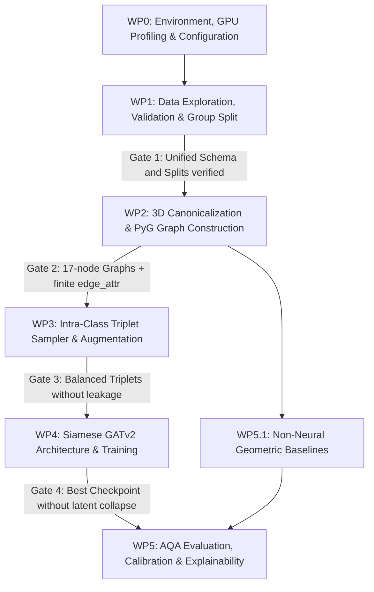

# Operational Sub-Specification: Task Decomposition, Implementation Modalities ("How"), and Constraints

**Project:** Siamese GATv2 for Action Quality Assessment (AQA) in Figure Skating  
**Parent document:** [specifica_implementativa_gnn_pattinaggio.md](file:///c:/MAGISTRALE/DeepLearningBigData/Pose%20Landmark/specifica_implementativa_gnn_pattinaggio.md)  
**Critical reference:** [Revisione critica progetto GNN sportivo.pdf](file:///c:/MAGISTRALE/DeepLearningBigData/Pose%20Landmark/Revisione%20critica%20progetto%20GNN%20sportivo.pdf)  
**Time horizon:** 14 days (Academic MVP — *Big Data and Deep Learning*)

---

## 1. Architectural Analysis of the Parent Specification

Cross-analysis of the implementation specification and the critical review shows that the success of the project (and its defensibility at the exam) does not depend on the complexity of the neural architecture, but rather on respecting **6 blocking structural constraints (Gating Constraints)**:

1. **Empirical validation of the source data before model code:** FineFS `.npz` files and GOE annotations must never be assumed as a black box. Before building graphs, it is necessary to prove that the coordinates are genuinely 3D, identify the $(X, Y, Z)$ coordinate system, map the exact ordering of the 17 joints, and verify that the GOE is associated with the individual technical sub-element and not just the entire program.
2. **Strict prevention of Data Leakage via Group Split:** Adjacent frames or repetitions of the same element in the same performance/athlete have very high spatial correlation. The `train / val / test` split must occur at the **performance and athlete** level *before* any data augmentation, reference prototype calculation, or calibration.
3. **Mathematical order between 3D Canonicalization and Temporal Averaging:** In figure skating *Spins*, the athlete rotates around the vertical axis. If the coordinate average $\bar{P} = \frac{1}{T}\sum_t P_t$ were computed *before* **Yaw Alignment**, continuous rotation would cause the limbs to collapse toward the rotation axis due to vector cancellation. Every single frame $t$ must therefore be centered, scaled, and rotated into the canonical system **before** performing the temporal aggregation $\bar{P}$.
4. **Justification of the GNN against the "Subtraction Paradox":** Since the 17 skeleton nodes are already indexed and semantically corresponding between two graphs ($G_A$ and $G_B$), the use of a Siamese GATv2 is justified only if it learns a biomechanically weighted non-linear metric (capturing postural compensations along the kinematic chain) that empirically outperforms a simple **non-neural trigonometric/Euclidean baseline**.
5. **Semantic consistency of Triplets (Intra-Class):** The Triplet Loss must compare $(G_{\text{Anchor}}, G_{\text{Positive}}, G_{\text{Negative}})$ belonging **to the same technical element** (e.g., all three *Camel Spin*). Mixing different elements would silently turn the *Action Quality Assessment* task into *Action Recognition*.
6. **Isolation of Domain Shift at Inference (HRNet vs MediaPipe):** The model trained on FineFS's 17 HRNet 3D keypoints cannot directly receive MediaPipe's 33 landmarks without a topological projection operator $P: \mathbb{R}^{33 \times 3} \to \mathbb{R}^{17 \times 3}$ and a distributional alignment check (*Keypoint-level Domain Alignment*).

### 1.1 Map of Sub-Specifications (Work Packages) and Dependencies



---

## 2. WP0 — Environment Setup, Hardware Profiling, and Base Configuration

### Task 0.1 — Hardware Profiling (GPU/VRAM/CUDA) and Dependency Pinning
- **Target files:** `requirements.txt`, `src/utils/env_check.py`
- **Objective:** Detect the actual capabilities of the machine (Asus Vivobook Pro 15 with Ryzen 6000 and NVIDIA Mobile GPU) and ensure PyTorch and PyTorch Geometric (PyG) operate both on low-VRAM GPUs (4–6 GB) and with CPU fallback.
- **How (Implementation modality):**
  1. Write a script `src/utils/env_check.py` that queries `torch.cuda.is_available()`, `torch.cuda.get_device_name(0)`, and `torch.cuda.get_device_properties(0).total_memory`.
  2. Verify the installation of `torch`, `torch_geometric`, and the compatibility of `GATv2Conv(..., edge_dim=..., return_attention_weights=True)` by instantiating a synthetic 17-node, 32-edge graph and running a test forward + backward pass.
  3. Pin exact versions in `requirements.txt` (`numpy`, `scipy`, `torch`, `torch-geometric`, `scikit-learn`, `matplotlib`, `pyyaml`, `pytest`).
- **Constraints:**
  - **VRAM Budget:** Peak allocated memory during training (`torch.cuda.max_memory_allocated()`) must not exceed **1.0 GB** to allow stable execution even on 4 GB RTX 3050 Mobile cards.
  - **CPU Fallback:** No module may contain hardcoded `.cuda()` calls; the device (`cuda` or `cpu`) must be passed dynamically via a `torch.device` object.
  - **Offline Execution:** Training must never decode `.mp4`/`.avi` video files into GPU memory.

### Task 0.2 — Declarative Configuration and Deterministic Reproducibility
- **Target files:** `configs/data.yaml`, `configs/graph.yaml`, `configs/training.yaml`, `src/utils/seed.py`
- **Objective:** Centralize all hyperparameters, anatomical conventions, and random seeds in versioned YAML files.
- **How (Implementation modality):**
  1. Implement `set_global_seed(seed: int = 42)` which sets `random.seed`, `np.random.seed`, `torch.manual_seed`, `torch.cuda.manual_seed_all`, and sets `torch.backends.cudnn.deterministic = True`.
  2. Create `configs/data.yaml` (dataset paths, selected technical elements, split percentages, window frame count $T$, threshold $\epsilon = 10^{-6}$).
  3. Create `configs/graph.yaml` (semantic map of the 17 joints, list of anatomical edge pairs $E$, list of joint triplets $(i, j, k)$ associated with each edge for computing $\cos\theta_{ijk}$).
  4. Create `configs/training.yaml` (hidden/embedding dimensions $d \in \{32, 64\}$, `heads: 4`, `dropout`, learning rate, weight decay, fixed/adaptive margin strategy, and GOE thresholds).
- **Constraints:**
  - **Ban on Magic Numbers:** It is forbidden to hardcode joint indices (e.g., `11`, `12`, `5`, `6`), GOE thresholds, or margin values $\alpha$ directly inside Python files in `src/models/` or `src/training/`. Everything must be read from the YAML files.

---

## 3. WP1 — Data Sub-Specification: Exploration, Validation, Harmonization, and Split (Days 1–3)

### Task 1.1 — Structural Inspection and Validation of FineFS
- **Target files:** `notebooks/01_dataset_exploration.ipynb`, `src/data/loaders.py`, `reports/data_audit_finefs.md`
- **Objective:** Inspect the actual contents of FineFS `.npz` files and annotation files to verify design assumptions before writing preprocessing code.
- **How (Implementation modality):**
  1. Load a representative sample of `.npz` files with `np.load(..., allow_pickle=True)` and list all keys (`files`), `dtype`s, and `shape`s of the contained arrays.
  2. Verify that keypoint coordinates have a shape reducible to $(T_{\text{tot}}, 17, 3)$ (or $(T_{\text{tot}}, 17, 4)$ if the fourth channel is confidence).
  3. Plot in 3D (projections on the $XY$, $XZ$, $YZ$ planes) a skeleton in an upright pose to empirically identify:
     - The exact index of each of the 17 joints (verifying correspondence with the COCO/Human3.6M standard used by HRNet: pelvis/hips, shoulders, elbows, wrists, knees, ankles, head/nose).
     - The direction and physical meaning of the $X$, $Y$, and $Z$ axes (e.g., which axis represents the gravitational vertical against which Yaw is rotated).
  4. Analyze the JSON/CSV annotation files to reconstruct the join key between skeleton file, temporal interval `[start_frame, end_frame]`, technical element class (`element_label`), and `goe` score.
  5. Quantify the percentage of frames with `NaN`, `Inf`, all-zero skeletons (`np.allclose(kp, 0)`), or segments with duration $T_{\text{seg}} < 5$ frames.
- **Constraints (CRITICAL GATING):**
  - **Project block on misalignment:** It is not permitted to proceed to Task 1.4 or WP2 until the exact map `{index_0_16: anatomical_name}` and the actual vertical axis of the 3D reference system are documented in `reports/data_audit_finefs.md`.
  - **GOE granularity check:** If in some records the GOE is reported only at the whole-performance level and not per segmented individual element, such records must be filtered out and excluded from training.

### Task 1.2 — Compatibility Verification Protocol and Possible Exclusion of MMFS
- **Target files:** `src/data/harmonization.py`
- **Objective:** Objectively establish whether the supplementary MMFS dataset can be merged with FineFS or must be discarded to avoid artificial *domain shift*.
- **How (Implementation modality):**
  1. Run an 8-point compatibility checklist on MMFS relative to FineFS:
     - Ordering and semantics of the 17 joints;
     - Dimensionality (2D vs 3D) and coordinate system;
     - Pose estimator used (HRNet) and output format;
     - Units of measurement and average bone length proportions post-normalization;
     - Temporal definition of segments;
     - Scale and semantics of the GOE score;
     - Presence of performance/athlete identifiers;
     - Overlap check (same competitions/videos present in both FineFS and MMFS).
- **Constraints:**
  - **Ban on blind concatenation:** It is strictly forbidden to merge MMFS samples with FineFS just because both present tensors of dimension $17 \times 3$.
  - **Exclusion rule (Fail-Safe):** If MMFS has 2D-only coordinates, an incompatible 17-joint topology, a non-alignable GOE scale, or the risk of duplicating performances already present in FineFS (causing leakage between train and test), **MMFS must be excluded from the MVP** (cf. §3.2 and §17 of the parent specification).

### Task 1.3 — Data-Driven Selection of Target Technical Elements
- **Target files:** `src/data/segmentation.py`, `configs/data.yaml`
- **Objective:** Select 1 to 3 skating technical elements equipped with a stable holding phase (e.g., *Camel Spin*, *Sit Spin*, *Layback Spin*) and with sufficient statistical coverage.
- **How (Implementation modality):**
  1. Compute for each element class present in FineFS:
     - Total number of valid instances $N_c$;
     - Number of distinct performances/athletes;
     - Empirical GOE distribution (mean, median, $25^{\text{th}}$ and $75^{\text{th}}$ percentiles, count of samples with $\text{GOE} \ge \tau_{\text{pos}}$ and $\text{GOE} \le \tau_{\text{neg}}$);
     - Average segment duration in frames $(\text{end\_frame} - \text{start\_frame})$.
  2. Select the classes (1 to 3) that maximize sample count and guarantee the presence of both excellent executions (Anchor/Positive) and sub-optimal executions (Negative).
- **Constraints:**
  - Do not select very fast multi-rotation jumps if temporal sampling does not allow isolating a reproducible phase; give top priority to **Spins** or **Spirals** where the canonical pose is held for multiple consecutive frames.

### Task 1.4 — Construction of the Unified Data Schema (`UnifiedSample`)
- **Target files:** `src/data/harmonization.py`, `data/intermediate/unified_manifest.jsonl`
- **Objective:** Encapsulate each valid segment into the standardized schema specified in §3.4 of the parent specification.
- **How (Implementation modality):**
  1. Define a `dataclass` (or Pydantic/TypedDict model) `UnifiedSample` with the mandatory fields:
     - `sample_id: str` (e.g., `"finefs_perf0142_elem03"`)
     - `dataset_id: str` (`"finefs"` or `"mmfs"`)
     - `performance_id: str`
     - `athlete_id: Optional[str]`
     - `element_label: str`
     - `start_frame: int`
     - `end_frame: int`
     - `keypoints: np.ndarray` of shape `(T_seg, 17, 3)` in `float32`
     - `keypoint_confidence: Optional[np.ndarray]` of shape `(T_seg, 17)`
     - `goe: float`
     - `source_metadata: dict` (source `.npz` file, original annotation index, validity flags).
  2. Save the complete index in `data/intermediate/` keeping a log of discarded samples with their reason (`missing_goe`, `corrupted_keypoints`, `too_short`).
- **Constraints:**
  - **Reversible traceability:** Given any `sample_id` during testing or explainability, it must be possible to trace back in $O(1)$ time to the original `.npz` file, the performance, and the frame interval `[start_frame, end_frame]`.

### Task 1.5 — Anti-Leakage Partitioning by Performance/Athlete
- **Target files:** `src/data/loaders.py`, `data/splits/split_v1.json`
- **Objective:** Split `sample_id`s into `train` (70%), `val` (15%), and `test` (15%) guaranteeing total disjointness of performances and athletes.
- **How (Implementation modality):**
  1. Build the grouping key `group_key = athlete_id if athlete_id is not None else performance_id`.
  2. Use `StratifiedGroupKFold` or `GroupShuffleSplit` (from `scikit-learn`) to generate the three subsets while keeping the proportion of `element_label` classes and `goe` distribution balanced across the three splits.
  3. Run an automatic post-split assertion:
     $$\text{Groups}(\text{train}) \cap \text{Groups}(\text{val}) = \emptyset, \quad \text{Groups}(\text{train}) \cap \text{Groups}(\text{test}) = \emptyset, \quad \text{Groups}(\text{val}) \cap \text{Groups}(\text{test}) = \emptyset$$
  4. Serialize the split IDs into `data/splits/split_v1.json`.
- **Constraints (CRITICAL GATING):**
  - **Zero Frame/Performance Leakage:** It is strictly forbidden to perform a simple random split (`train_test_split` on individual samples) that sends two spins from the same performance one into training and one into test.
  - **Immutability of the Test Set:** Once `split_v1.json` is generated, `test` set samples must never be used to choose GOE thresholds, calibrate $\beta$, or select hyperparameters.

---

## 4. WP2 — Geometric Preprocessing and Graph Construction Sub-Specification (Days 4–5)

### Task 2.1 — Temporal Windowing of the Stable Phase and Frame Quality Filtering
- **Target files:** `src/data/segmentation.py`
- **Objective:** Extract from each `[start_frame, end_frame]` segment a window of $T$ valid frames belonging to the same stable kinematic phase of the element.
- **How (Implementation modality):**
  1. Given a segment of length $L = \text{end\_frame} - \text{start\_frame}$, isolate the stable central portion (e.g., discarding the first $20\%$ spin entry and the last $20\%$ exit, and sampling the $T$ central frames around $\lfloor L/2 \rfloor$, with $T \in [5, 15]$ configurable in `configs/data.yaml`).
  2. For each candidate frame $t$, verify that:
     - None of the 17 joints contains `NaN` or `Inf`;
     - If `keypoint_confidence` is available, the average confidence on critical joints (hips, shoulders, knees, elbows) exceeds the minimum threshold `min_conf`.
  3. If a segment has fewer than $T_{\min}$ valid frames in the central window, mark the sample as `invalid_window` and discard it.
- **Constraints:**
  - **Ban on averaging across heterogeneous phases:** One must never average all frames from `start_frame` to `end_frame` indiscriminately, because averaging the standing preparation with the lowered pose (e.g., *Sit Spin*) produces a deformed and physically non-existent intermediate skeleton.

### Task 2.2 — Frame-by-Frame 3D Geometric Canonicalization and Aggregation
- **Target files:** `src/data/preprocessing.py`, `tests/test_normalization.py`
- **Objective:** Remove global translation, anthropometric/camera scale differences, and yaw rotation on each individual frame $t$, before computing the average skeleton $\bar{P} \in \mathbb{R}^{17 \times 3}$.
- **How (Implementation modality):**
  For each valid frame $P_t \in \mathbb{R}^{17 \times 3}$ in the selected window, apply in sequence:
  1. **Root-Centering (Translation invariance):**
     $$p_{\text{pelvis}} = \frac{p_{11} + p_{12}}{2}, \qquad p'_i = p_i - p_{\text{pelvis}} \quad \forall i \in \{0, \dots, 16\}$$
  2. **Scale Normalization (Invariance to camera distance and height):**
     $$p_{\text{shoulders}} = \frac{p_5 + p_6}{2}, \qquad s = \|p_{\text{shoulders}} - p_{\text{pelvis}}\|_2$$
     Verify that $s > \epsilon_{\text{scale}}$ (with $\epsilon_{\text{scale}} = 10^{-4}$). If valid:
     $$p''_i = \frac{p'_i}{s}$$
  3. **Yaw Alignment (Invariance to horizontal camera angle and spin rotation):**
     Compute the pelvic vector on the horizontal plane (identified in Task 1.1, assuming here $X$-$Y$ with $Z$ vertical axis):
     $$v_{\text{hip}} = p''_{12} - p''_{11}, \qquad \|v_{\text{hip}, xy}\|_2 = \sqrt{v_{\text{hip}, x}^2 + v_{\text{hip}, y}^2}$$
     Verify that $\|v_{\text{hip}, xy}\|_2 > \epsilon_{\text{yaw}}$. Compute the angle $\theta = \operatorname{atan2}(v_{\text{hip}, y}, v_{\text{hip}, x})$ and rotate each joint by $-\theta$ around the vertical axis:
     $$p'''_i = R_z(-\theta) p''_i, \qquad R_z(-\theta) = \begin{bmatrix} \cos(-\theta) & -\sin(-\theta) & 0 \\ \sin(-\theta) & \cos(-\theta) & 0 \\ 0 & 0 & 1 \end{bmatrix}$$
  4. **Temporal Aggregation on canonicalized frames:**
     $$\bar{P} = \frac{1}{T} \sum_{t=1}^{T} P'''_t \in \mathbb{R}^{17 \times 3}$$
  5. **Diagnostic logging:** Save for each sample the mean and standard deviation of $s$, the angles $\theta_t$, and the post-alignment inter-frame variance $\frac{1}{T}\sum_t \|P'''_t - \bar{P}\|_F^2$ (useful to verify that the pose in the window is actually stable!).
- **Constraints:**
  - **Strict order of operations:** Canonicalization $(1 \to 2 \to 3)$ must be executed **frame by frame before averaging (4)**. Reversing the order (averaging before rotating) is a blocking mathematical error.
  - **Explicit handling of degenerate cases:** If $s \le \epsilon_{\text{scale}}$ (collapsed torso) or $\|v_{\text{hip}, xy}\|_2 \le \epsilon_{\text{yaw}}$ (hips vertically overlapping), it is forbidden to leave the skeleton unscaled (`scaled = centered` as in the illustrative snippet of the review) or divide by zero: the frame must be discarded and accounted for in the logs.
  - **Ban on blind mirroring:** Never apply automatic sign inversions on axes (left/right `flip`), as they would swap the chirality of the pose relative to the semantic indices of left and right nodes.

### Task 2.3 — Fixed 17-Node Topology Construction and `x` + `edge_attr` Computation
- **Target files:** `src/graph/topology.py`, `src/graph/features.py`, `tests/test_graph.py`
- **Objective:** Transform the canonicalized pose $\bar{P} \in \mathbb{R}^{17 \times 3}$ into the node feature matrix `x`, connectivity `edge_index`, and edge geometric features `edge_attr`.
- **How (Implementation modality):**
  1. **Topology (`edge_index`):** Load from `configs/graph.yaml` the 16 anatomical connections of the 17-joint skeleton. Since in GNN message passing information must flow both proximally-to-distally (e.g., shoulder $\to$ elbow) and distally-to-proximally (elbow $\to$ shoulder), represent each bone with **two opposite directed edges** $(i \to j)$ and $(j \to i)$, obtaining $|E| = 32$ directed edges and `edge_index` of shape `(2, 32)` in `torch.long`.
  2. **Node Features (`x`):**
     - *Baseline* configuration: canonicalized 3D coordinates $x_i = [\bar{x}_i, \bar{y}_i, \bar{z}_i] \in \mathbb{R}^3$, so `x` has shape `(17, 3)`.
     - *Extended* configuration (optional, toggleable from config for ablation studies): concatenation with mean joint confidence or radial distance from root $\|\bar{p}_i\|_2$.
  3. **Edge Features (`edge_attr`):** For each directed edge $e = (i \to j) \in E$:
     - **Unit directional bone vector ($\mathbb{R}^3$):**
       $$u_{ij} = \frac{\bar{p}_j - \bar{p}_i}{\|\bar{p}_j - \bar{p}_i\|_2 + \epsilon}$$
     - **Normalized bone length ($\mathbb{R}^1$):**
       $$l_{ij} = \|\bar{p}_j - \bar{p}_i\|_2$$
     - **Joint angle cosine ($\mathbb{R}^1$):** Since an angle $\theta_{ijk}$ is defined on a triplet of nodes $(i, j, k)$ centered at joint $j$, define in `configs/graph.yaml` a **fixed deterministic map** `EDGE_ANGLE_TRIPLETS` that associates each of the 32 directed edges $(i \to j)$ with a specific reference anatomical triplet $(i, j, k)$ (where $k$ is the main adjacent bone on joint $j$):
       $$\cos(\theta_{ijk}) = \frac{(\bar{p}_i - \bar{p}_j) \cdot (\bar{p}_k - \bar{p}_j)}{\|\bar{p}_i - \bar{p}_j\|_2 \|\bar{p}_k - \bar{p}_j\|_2 + \epsilon} \in [-1, 1]$$
     - Concatenate the components, obtaining for each edge the constant vector:
       $$e_{ij} = \left[ u_{ij, x},\; u_{ij, y},\; u_{ij, z},\; l_{ij},\; \cos(\theta_{ijk}) \right] \in \mathbb{R}^5$$
       so `edge_attr` has shape `(32, 5)` in `torch.float32`.
- **Constraints:**
  - **Absolute topological invariance:** All graphs in the dataset (train, val, test, demo) must have exactly `num_nodes == 17`, the exact same `edge_index` of shape `(2, 32)`, and `edge_attr` of shape `(32, 5)`.
  - **Numerical check:** Before returning the graph, execute `assert torch.isfinite(x).all()` and `assert torch.isfinite(edge_attr).all()`.

### Task 2.4 — PyTorch Geometric Serialization and Traceability
- **Target files:** `src/graph/builder.py`, `data/processed/`
- **Objective:** Save the preprocessed dataset to disk as a collection of `torch_geometric.data.Data` objects ready for fast training.
- **How (Implementation modality):**
  1. For each valid `UnifiedSample`, build the `Data` object:
     ```python
     data = Data(
         x=x_tensor,                  # shape: (17, 3)
         edge_index=edge_index,       # shape: (2, 32)
         edge_attr=edge_attr_tensor,  # shape: (32, 5)
         y=torch.tensor([sample.goe], dtype=torch.float32),
         sample_id=sample.sample_id,
         element_label=sample.element_label,
         performance_id=sample.performance_id,
         athlete_id=sample.athlete_id or "unknown",
         split=assigned_split,
         is_augmented=False
     )
     ```
  2. Save the serialized files in `data/processed/{train,val,test}_graphs.pt` along with a statistics file `data/processed/preprocessing_report.json`.
- **Constraints:**
  - Every serialized `Data` object must retain the `sample_id` attribute to allow immediate join with the original metadata during evaluation and visualization.

---

## 5. WP3 — Metric Learning Sub-Specification: Triplet Sampler and Data Augmentation (Day 6)

### Task 3.1 — Implementation of the GOE-Based Intra-Class Triplet Sampler
- **Target files:** `src/training/triplet_sampler.py`, `tests/test_triplets.py`
- **Objective:** Generate semantically coherent triplets $(G_A, G_P, G_N)$ from real GOE scores (and augmented samples in the training set only).
- **How (Implementation modality):**
  1. Partition the graphs of the current split by technical element class $c \in \mathcal{C}$.
  2. Within the same class $c$, define three tiers based on the empirical GOE distribution (configurable in `configs/training.yaml`, e.g., initial thresholds $\tau_{\text{pos}} = +2.0$ or $75^{\text{th}}$ percentile of the class, and $\tau_{\text{neg}} = 0.0$ or $25^{\text{th}}$ percentile):
     - **Anchor/Positive Pool ($\mathcal{P}_c^+$):** high-quality executions ($\text{GOE} \ge \tau_{\text{pos}}$), unperturbed (`is_augmented == False`).
     - **Negative Pool ($\mathcal{P}_c^-$):** low-quality real executions ($\text{GOE} \le \tau_{\text{neg}}$) plus (in the training set only) the perturbed synthetic samples generated by Task 3.3.
  3. To draw a valid triplet $(G_A, G_P, G_N)$:
     - Sample $G_A \in \mathcal{P}_c^+$ and $G_P \in \mathcal{P}_c^+$ enforcing that $G_A$ and $G_P$ come from **different performances** (`A.performance_id != P.performance_id`) and satisfy $|\text{GOE}(A) - \text{GOE}(P)| \le \delta_{\text{pos}}$.
     - Sample $G_N \in \mathcal{P}_c^-$ enforcing that $\text{GOE}(A) - \text{GOE}(N) \ge \Delta_{\min}$ (if real negative) or that $G_N$ is a controlled geometric perturbation of class $c$.
- **Constraints:**
  - **Absolute Intra-Class Constraint:** `assert A.element_label == P.element_label == N.element_label`.
  - **Ban on Self-Pairing:** `assert A.sample_id != P.sample_id` and `assert A.performance_id != P.performance_id` (otherwise the model learns the athlete's residual biometric identity instead of pose quality).
  - **Determinism in Validation and Test:** The validation and test triplet sets must be generated once with a fixed seed and kept unchanged across all epochs to make learning curves comparable.

### Task 3.2 — `AdaptiveTripletMarginLoss` Cost Function
- **Target files:** `src/training/losses.py`
- **Objective:** Implement the Triplet Margin Loss supporting both a fixed margin $\alpha_0$ and an adaptive margin $\alpha_{AN}$ depending on the quality gap between Anchor and Negative.
- **How (Implementation modality):**
  1. Compute the Euclidean distances in latent space for each triplet $b$ in the batch:
     $$d_{AP}^{(b)} = \|z_A^{(b)} - z_P^{(b)}\|_2, \qquad d_{AN}^{(b)} = \|z_A^{(b)} - z_N^{(b)}\|_2$$
  2. Determine the margin vector $\alpha^{(b)}$ according to the mode set in `configs/training.yaml`:
     - **`fixed` mode:** $\alpha^{(b)} = \alpha_0$ (e.g., $\alpha_0 = 0.5$).
     - **`adaptive` mode:** map the severity of the difference $\Delta q^{(b)} = \text{GOE}(A^{(b)}) - \text{GOE}(N^{(b)})$ (or the `severity_tier` $\in \{1, 2, 3\}$ of the synthetic negative) to the three discrete levels:
       $$\alpha^{(b)} = \begin{cases} 0.2 & \text{if mild error (Tier 1)} \\ 0.6 & \text{if medium error (Tier 2)} \\ 1.0 & \text{if severe error (Tier 3)} \end{cases}$$
  3. Compute the mean loss over the batch:
     $$\mathcal{L} = \frac{1}{B} \sum_{b=1}^{B} \max\left( d_{AP}^{(b)} - d_{AN}^{(b)} + \alpha^{(b)},\; 0 \right)$$
- **Constraints:**
  - The assignment rule for $\alpha^{(b)}$ must be a pure, deterministic function with no stochastic branches.
  - Plan a mandatory ablation study (`fixed` vs `adaptive`) during evaluation to verify whether the adaptive margin actually improves Spearman correlation $\rho$.

### Task 3.3 — Biomechanically Controlled Geometric Data Augmentation
- **Target files:** `src/training/augmentation.py`
- **Objective:** Enrich the training set with synthetic negative executions of known severity and realistic positive variations to counter class imbalance (*Selection Bias* of elite athletes).
- **How (Implementation modality):**
  1. Starting from a high-quality canonical pose $\bar{P} \in \mathbb{R}^{17 \times 3}$ from the **training set only**:
     - **Positive Augmentation (Invariance to estimation noise):** add low-amplitude isotropic Gaussian noise $\eta \sim \mathcal{N}(0, \sigma_{\text{pos}}^2 I)$ with $\sigma_{\text{pos}} \le 0.01$ (in torso-length units) and global micro-rotations $|\delta \psi| \le 3^\circ$.
     - **Synthetic Negative Generation (Tree-Based Kinematic Perturbation):** select a pivot joint $j$ relevant to the element (e.g., hip of the free leg in *Camel Spin*, or knee of the skating leg in *Sit Spin*) and apply a 3D rotation matrix $R_{\mathbf{u}}(\delta \theta)$ to **the entire descending kinematic subtree** from $j$ (e.g., rotating the hip rigidly moves the connected knee and ankle, preserving bone lengths!):
       $$\bar{p}'_m = \bar{p}_j + R_{\mathbf{u}}(\delta \theta)(\bar{p}_m - \bar{p}_j) \quad \forall m \in \text{Subtree}(j)$$
       with three angular deviation tiers:
       - *Mild (Tier 1, $\alpha=0.2$):* $\delta \theta \in [8^\circ, 15^\circ]$
       - *Medium (Tier 2, $\alpha=0.6$):* $\delta \theta \in [16^\circ, 28^\circ]$
       - *Severe (Tier 3, $\alpha=1.0$):* $\delta \theta \in [29^\circ, 45^\circ]$
  2. After every perturbation of the coordinates $\bar{P}'$, **recompute from scratch** the canonicalization step and the `build_graph(P_prime)` function from Task 2.3 so that `x` and `edge_attr` (bone vectors and angle cosines) accurately reflect the new geometry.
- **Constraints:**
  - **Split Isolation:** Augmentation must be executed **exclusively on graphs with `split == "train"`**. No synthetic graph may enter the `val` or `test` pools (except in a separate noise sensitivity test battery, cf. §12.2).
  - **Bone Length Conservation:** It is forbidden to perturb a single leaf or intermediate node without translating/rotating the entire descending subtree, as this would artificially stretch or shrink skeleton bones creating non-anatomical artifacts.
  - **Traceability of Synthetics:** Every generated graph must have `is_augmented = True`, `parent_sample_id`, `perturbation_joint`, `perturbation_angle_deg`, and `severity_tier`, without assigning fictitious official ISU penalty labels.

---

## 6. WP4 — Model Sub-Specification: Siamese GATv2 Architecture and Training Loop (Days 7–10)

### Task 4.1 — `GATv2Encoder` and `SiameseGATv2` Wrapper Implementation
- **Target files:** `src/models/encoder.py`, `src/models/siamese_gat.py`
- **Objective:** Implement the graph encoder with dynamic attention sensitive to edge features (`edge_attr`) and the shared-weight Siamese module.
- **How (Implementation modality):**
  1. Build `GATv2Encoder(nn.Module)`:
     - **Layer 1:** `GATv2Conv(in_channels=node_dim, out_channels=hidden_dim, heads=4, concat=True, dropout=dropout, edge_dim=edge_dim, add_self_loops=True)` $\to$ `ELU()` $\to$ `Dropout(p)`. Output of dimension `(N, 4 * hidden_dim)`.
     - **Layer 2:** `GATv2Conv(in_channels=4 * hidden_dim, out_channels=hidden_dim, heads=4, concat=False, dropout=dropout, edge_dim=edge_dim, add_self_loops=True)` $\to$ `ELU()`. Output of dimension `(N, hidden_dim)`.
     - **Global Readout:** `global_mean_pool(h, batch)` aggregating the 17 nodes of each graph in the batch into a single graph vector `(B, hidden_dim)`.
     - **Projection Head:** `nn.Linear(hidden_dim, embed_dim)` (with `embed_dim` $\in \{32, 64\}$). Optional $L_2$ normalization controllable via config (`normalize_embeddings: bool`).
     - Support for the `return_attention_weights: bool = False` flag in `forward(x, edge_index, edge_attr, batch, return_attention_weights=False)` returning `(z, attn_dict)` when requested.
  2. Build `SiameseGATv2(nn.Module)`:
     - Contains **a single attribute** `self.encoder = GATv2Encoder(...)`.
     - The `forward_triplet(batch_A, batch_P, batch_N)` method invokes `self.encoder` on the three PyG batches and returns `(z_A, z_P, z_N)`.
     - The `forward_pair(batch_A, batch_R)` method returns `(z_A, z_R)` and the Euclidean distance $d = \|z_A - z_R\|_2$.
- **Constraints:**
  - **Weight Sharing:** It is forbidden to instantiate two or three distinct `GATv2Encoder` objects. An automated test must verify that the total number of parameters of `SiameseGATv2` matches exactly that of a single `GATv2Encoder`.
  - **Effective use of `edge_attr`:** Every call to `GATv2Conv` must explicitly pass `edge_attr=edge_attr` and have `edge_dim=5` configured at initialization.
  - **Anti-overfitting compactness:** The total number of trainable parameters in the encoder must remain small (indicatively $< 50,000$ parameters) to avoid memorizing the few hundred real skeletons.

### Task 4.2 — Training Loop, Anti-Collapse Monitoring, and Early Stopping
- **Target files:** `src/training/train.py`, `checkpoints/`
- **Objective:** Train the Siamese network while monitoring generalization on validation and preventing latent space collapse.
- **How (Implementation modality):**
  1. Use `torch_geometric.loader.DataLoader` to pack triplets into mini-batches (e.g., `batch_size = 32` or `64`).
  2. Optimizer `torch.optim.AdamW(model.parameters(), lr=1e-3, weight_decay=1e-4)` with `ReduceLROnPlateau` scheduler on the validation Triplet Loss.
  3. At each epoch, record in a structured file `reports/training_history.json`:
     - `train_loss`, `val_loss`;
     - `train_triplet_acc`, `val_triplet_acc` (% of triplets where $d(A,P) < d(A,N)$);
     - Mean positive distance $\bar{d}_{AP}$ and negative distance $\bar{d}_{AN}$;
     - Mean standard deviation of latent coordinates $\sigma_z = \text{mean}(\text{std}(z, \text{dim}=0))$.
  4. Save the checkpoint `checkpoints/best_model.pt` when `val_triplet_acc` (or `val_loss` on an accuracy tie) improves, applying **Early Stopping** after `patience` epochs (e.g., 15–20 epochs) without improvement.
- **Constraints:**
  - **Representation Collapse Guard:** If $\sigma_z < 10^{-4}$ or if $\bar{d}_{AP} \approx \bar{d}_{AN} \approx 0$, the training loop must raise an explicit representation collapse warning.
  - **Training Efficiency:** During the training loop, `return_attention_weights` must remain set to `False` so as not to allocate unnecessary tensors in the computational graph.

---

## 7. WP5 — Evaluation, Baselines, Calibration, and Explainability Sub-Specification (Days 11–14)

### Task 5.1 — Implementation and Comparison with Non-Neural Geometric Baselines
- **Target files:** `src/evaluation/evaluate.py`
- **Objective:** Experimentally answer the fundamental exam critique (*"Why use a GNN instead of a simple trigonometric subtraction?"*) by comparing the Siamese GATv2 against three direct mathematical baselines on the same test data.
- **How (Implementation modality):**
  Implement three distance estimators without trainable parameters operating directly on the preprocessed graphs from Task 2.3:
  1. **Baseline 1 — Euclidean Distance of Canonical Coordinates ($d_{\text{coord}}$):**
     $$d_{\text{coord}}(G_A, G_B) = \|\text{vec}(\bar{P}_A) - \text{vec}(\bar{P}_B)\|_2 = \sqrt{\sum_{i=0}^{16} \|\bar{p}_{A,i} - \bar{p}_{B,i}\|_2^2}$$
  2. **Baseline 2 — Euclidean Distance on Joint Angles ($d_{\text{angle}}$):**
     Extracting the fifth column of `edge_attr` ($\mathbf{c} = [\cos\theta_1, \dots, \cos\theta_{32}]^\top$):
     $$d_{\text{angle}}(G_A, G_B) = \|\mathbf{c}_A - \mathbf{c}_B\|_2$$
  3. **Baseline 3 — Cosine Distance on Concatenated Features ($d_{\text{cos}}$):**
     $$d_{\text{cos}}(G_A, G_B) = 1 - \frac{\mathbf{f}_A \cdot \mathbf{f}_B}{\|\mathbf{f}_A\|_2 \|\mathbf{f}_B\|_2}, \qquad \mathbf{f} = [\text{vec}(x) \;\|\; \text{vec}(\text{edge\_attr})]$$
  Compute for all 3 baselines both **Triplet Accuracy** and **Spearman Rank Correlation ($\rho$)** on the test set and place them side by side in a comparative table with the Siamese GATv2 results.
- **Constraints (EXAM DEFENSE GATING):**
  - All baselines must be evaluated on the exact **same test triplets** and the **same reference prototypes** used to evaluate the Siamese GATv2.
  - Even if on individual sub-cases a baseline achieves results close to the GNN, the numbers must be reported in full and discussed scientifically (cf. §16.5 of the parent specification).

### Task 5.2 — Reference Prototype Construction, $Q$ Index Calibration, and AQA Metrics
- **Target files:** `src/evaluation/metrics.py`, `src/evaluation/evaluate.py`
- **Objective:** Evaluate the model's ability to rank real executions by quality and calibrate the monotonic transformation $Q \in [0, 100]$.
- **How (Implementation modality):**
  1. **Canonical Reference Construction per Class ($z_R^{(c)}$):** For each technical element $c$, select all high-quality samples belonging to the **training set only** ($\mathcal{R}_c^{\text{train}} = \{G \in \text{Train}_c \mid \text{GOE}(G) \ge \tau_{\text{ref}}, \text{is\_augmented}=\text{False}\}$) and compute the mean latent prototype:
     $$z_R^{(c)} = \frac{1}{|\mathcal{R}_c^{\text{train}}|} \sum_{G \in \mathcal{R}_c^{\text{train}}} f_\theta(G)$$
     (For non-neural baselines, the reference is the mean of features $\bar{P}_R^{(c)}$ and $\bar{\mathbf{c}}_R^{(c)}$ computed on the same set $\mathcal{R}_c^{\text{train}}$).
  2. **Reference Distance Calculation and Spearman $\rho$:** For each independent validation/test sample $G_i$ of class $c$, compute $d_i = \|f_\theta(G_i) - z_R^{(c)}\|_2$ and the Spearman rank correlation coefficient:
     $$\rho_c = \operatorname{SpearmanR}\left(\{-d_i\}_{i=1}^{N_c},\; \{\text{GOE}_i\}_{i=1}^{N_c}\right)$$
     reporting the value of $\rho_c$, the associated $p$-value, and the sample count $N_c$.
  3. **Calibration of the Internal Similarity Index $Q$:** Using **exclusively the validation set**, calibrate the scale parameter $\beta > 0$ in the formula:
     $$Q(d) = 100 \cdot \exp(-\beta d)$$
     for instance setting $\beta = \frac{-\ln(0.50)}{\text{median}(d_{\text{val}})}$ (so that the median validation distance corresponds to $Q = 50$, while $d \to 0 \implies Q \to 100$).
- **Constraints:**
  - **Ban on Test Leakage in Calibration:** Both the prototype $z_R^{(c)}$ and the constant $\beta$ must be fixed without ever reading the `test` set samples.
  - **Output Semantics:** In printouts, plots, and reports, $Q$ must always be labeled as *"Internal reference similarity index (0–100)"* and never as a direct GOE estimate or official ISU score.

### Task 5.3 — `GATv2` Attention Weight Extraction and Explainability Visualization
- **Target files:** `src/visualization/skeleton_plot.py`, `src/visualization/attention_plot.py`
- **Objective:** Extract attention coefficients $\alpha_{ij}$ from `GATv2Conv` layers and generate comparative visualizations between the athlete's execution and the reference pose.
- **How (Implementation modality):**
  1. In inference mode (`model.eval()`, `torch.no_grad()`), invoke `encoder(x, edge_index, edge_attr, return_attention_weights=True)` obtaining for each layer the tuple `(edge_index_attn, alpha)` where `alpha` has shape `(E_attn, H)` with $H=4$ heads.
  2. **Multi-head aggregation and anatomical edge symmetrization:**
     - Remove self-loops $(i \to i)$ to isolate inter-joint attention (or report them separately on nodes);
     - Compute the mean across the $H$ heads: $\bar{\alpha}_{i \to j} = \frac{1}{H}\sum_{h=1}^H \alpha_{i \to j}^{(h)}$;
     - For each of the 16 undirected bone segments $\{i, j\}$, compute the symmetric bone importance:
       $$w_{\{i,j\}} = \frac{\bar{\alpha}_{i \to j} + \bar{\alpha}_{j \to i}}{2}$$
  3. **Normalization and Plotting:**
     - Normalize the weights $w_{\{i,j\}}$ on a shared scale across the compared samples;
     - Generate a two-panel side-by-side figure (*Left Panel: Reference Prototype*, *Right Panel: Athlete Execution*) projecting the canonicalized skeletons onto the main plane and coloring each bone with a sequential colormap (e.g., `YlOrRd` / `inferno`) and line thickness proportional to $w_{\{i,j\}}$, displaying `element_label`, `real GOE`, distance $d(A,R)$, and index $Q$ in the title.
- **Constraints:**
  - **Visual Consistency:** When comparing two executions in the same figure (e.g., a *Camel Spin* with $\text{GOE} = +3$ and one with $\text{GOE} = -2$), the attention weight colorbar must use the same `[vmin, vmax]` bounds to avoid perceptual distortions.
  - **Interpretive Rigor:** Explicitly document that $w_{\{i,j\}}$ measures the relational weight assigned by `GATv2Conv` message passing to that joint connection, and does not by itself constitute proof of regulatory causality.

### Task 5.4 — End-to-End Inference Pipeline and MediaPipe Compatibility Guard
- **Target files:** `src/inference/predict.py`, `src/inference/video_pipeline.py`
- **Objective:** Provide a clean inference script for the exam demo, prioritizing held-out samples from the native domain and gating any external video extraction via MediaPipe on a geometric compatibility check.
- **How (Implementation modality):**
  1. **Primary Mode (Native Domain — Mandatory for the MVP):** The script `src/inference/predict.py` loads a FineFS `test` set sample never seen in training, runs the entire chain (windowing $\to$ 3D canonicalization $\to$ graph construction $\to$ `SiameseGATv2` $\to$ distance from $z_R^{(c)}$ $\to$ index $Q$ $\to$ attention plot) and saves the graphical and JSON output in less than 2 seconds.
  2. **Extended Mode (External Video via MediaPipe — Optional and Conditional):**
     - Implement in `src/inference/video_pipeline.py` the explicit projection matrix/map `MEDIAPIPE_33_TO_COCO_17` that maps MediaPipe's `pose_world_landmarks` onto the exact 17 indices of the HRNet standard verified in Task 1.1 (computing any midpoints such as hip-center or shoulder/neck-center if required by FineFS's HRNet standard).
     - Apply a temporal smoothing filter (e.g., Savitzky-Golay over a 5-frame window) before 3D canonicalization.
     - **Domain Verification Gate:** Compute the mean distance of normalized bone lengths $\|l_{\text{MediaPipe}} - \bar{l}_{\text{FineFS}}\|_2$ on a control pose. If the discrepancy exceeds the tolerance threshold (due to MediaPipe's monocular Z-depth distortions), flag the *domain shift* in the report and use only the Primary Mode for the official demo.
- **Constraints:**
  - **Ban on Unverified Hybrid Inference:** It is forbidden to pass raw MediaPipe coordinates or coordinates with $(X, Y, Z)$ axes not realigned to HRNet's camera/world convention to the `SiameseGATv2` model (in MediaPipe the $Y$ axis typically points downward!).

---

## 8. Automated Test Suite and Acceptance Criteria (`tests/`)

Each Work Package is considered complete (**Definition of Done**) only upon passing the respective automated unit tests runnable with `pytest`:

| Test File | Sub-Specification | Invariants and Constraints Verified by the Test |
| :--- | :--- | :--- |
| `tests/test_dataset.py` | **WP1** | 1. Loading `.npz` without losing `sample_id` and `source_metadata`.<br>2. Coordinate shape $(T, 17, 3)$ verified.<br>3. Absolute disjointness of `performance_id` and `athlete_id` sets across `train`, `val`, and `test`. |
| `tests/test_normalization.py` | **WP2 (Task 2.2)** | 1. **Root-centering:** $\left\|\frac{p'_{11} + p'_{12}}{2}\right\|_2 < 10^{-6}$.<br>2. **Scale normalization:** $\|p''_{\text{shoulders}} - p''_{\text{pelvis}}\|_2 = 1.0 \pm 10^{-5}$.<br>3. **Invariance to roto-translation and scale:** given a synthetic skeleton $P$, applying an arbitrary translation $+t_0$, a rescaling $\times \lambda$ ($\lambda > 0$), and a rotation around $Z$ by an angle $\phi \in [-\pi, \pi]$, the output of `canonicalize_3d` matches that of $P$ within tolerance $10^{-5}$.<br>4. **Degenerate handling:** a skeleton with all points coincident at $(0,0,0)$ is marked invalid without raising `ZeroDivisionError` or producing `NaN`. |
| `tests/test_graph.py` | **WP2 (Task 2.3–2.4)** | 1. `data.num_nodes == 17` and `data.edge_index.shape == (2, 32)`.<br>2. `data.edge_attr.shape == (32, 5)` and `torch.isfinite(data.edge_attr).all()`.<br>3. The norms of the directional vectors in the first 3 columns of `edge_attr` are unit ($\|u_{ij}\|_2 = 1.0 \pm 10^{-4}$) and the 5th column ($\cos\theta_{ijk}$) belongs to $[-1.0, 1.0]$.<br>4. Compatibility with `torch_geometric.loader.DataLoader` (batching 4 graphs without indexing errors). |
| `tests/test_triplets.py` | **WP3 & WP4** | 1. Every generated triplet satisfies `A.element_label == P.element_label == N.element_label`.<br>2. `A.performance_id != P.performance_id` and `A.split == P.split == N.split`.<br>3. No sample with `is_augmented == True` appears in the `val` or `test` splits.<br>4. `SiameseGATv2` shares weights across the 3 branches, produces a finite scalar loss with non-zero gradient (`param.grad is not None`), and returns attention weights of shape `(E_attn, heads)` when `return_attention_weights=True`. |

---

## 9. Sequential Execution Checklist (Recommended Operational Order)

1. **[ ] Day 1:** Execute **Task 0.1–0.2** (GPU/PyG check and YAML files) and start **Task 1.1** (FineFS `.npz` download and inspection).
2. **[ ] Day 2:** Complete the FineFS audit report (**Gate 1**: 17 joint indices, 3D axis orientation, GOE granularity) and decide on MMFS (**Task 1.2**).
3. **[ ] Day 3:** Select the 2–3 technical elements with the most data (**Task 1.3**), generate the unified manifest (**Task 1.4**), and run the anti-leakage Group Split (**Task 1.5**).
4. **[ ] Day 4:** Implement temporal windowing (**Task 2.1**) and frame-by-frame 3D canonicalization (**Task 2.2**), validating it with `pytest tests/test_normalization.py`.
5. **[ ] Day 5:** Implement `x` and `edge_attr` computation (**Task 2.3**), serialize PyG graphs to disk (**Task 2.4**), and validate `pytest tests/test_graph.py` (**Gate 2**).
6. **[ ] Day 6:** Implement the intra-class Triplet Sampler (**Task 3.1**), `AdaptiveTripletMarginLoss` (**Task 3.2**), and tree-based kinematic augmentation (**Task 3.3**), validating `pytest tests/test_triplets.py` (**Gate 3**).
7. **[ ] Day 7:** Immediately implement the 3 Non-Neural Geometric Baselines (**Task 5.1**) on the ready graphs: this immediately provides the reference benchmark to beat.
8. **[ ] Days 8–10:** Implement `GATv2Encoder` + `SiameseGATv2` (**Task 4.1**) and run training with anti-collapse monitoring and fixed vs adaptive margin ablation (**Task 4.2**, **Gate 4**).
9. **[ ] Days 11–12:** Compute reference prototypes $z_R^{(c)}$, calibrate $\beta$ on validation, compute Triplet Accuracy and Spearman $\rho$ on the test set comparing them against baselines (**Task 5.2**).
10. **[ ] Days 13–14:** Extract and plot `GATv2` attention weights (**Task 5.3**), finalize the demo script (**Task 5.4**), and write the final presentation.
