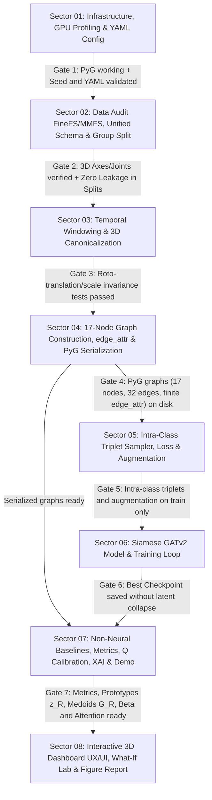

# 00 — Master Index of Sub-Specifications, API Contracts, and Dependencies

**Project:** Siamese GATv2 for Figure Skating Element Quality Assessment (AQA)  
**Parent Specification:** [specifica_implementativa_gnn_pattinaggio.md](file:///c:/MAGISTRALE/DeepLearningBigData/Pose%20Landmark/specifica_implementativa_gnn_pattinaggio.md)  
**Critical Review:** [Revisione critica progetto GNN sportivo.pdf](file:///c:/MAGISTRALE/DeepLearningBigData/Pose%20Landmark/Revisione%20critica%20progetto%20GNN%20sportivo.pdf)

---

## 1. Instructions for the Agent / Executing Model (Coding Guidelines)

This suite of specifications is designed to guide implementation step-by-step without ambiguity. The model tasked with writing the code must adhere to the following **software engineering rules**:

1. **Strict Adherence to Signatures (API Contracts):** Do not change the names of files, classes, functions, arguments, or YAML keys defined in these sub-specifications. Subsequent modules import the exact symbols specified in Table 3 below.
2. **Immediate Validation via Tests:** At the end of each individual sector, run the `pytest` command specified in the *Definition of Done* section of that sector. Never move to the next sector if any test fails.
3. **Path Handling on Windows/Linux:** Always use `pathlib.Path` to construct file paths, avoiding manual string concatenation with `/` or `\`.
4. **Typing and Docstrings:** Always include Python type hints (`from typing import Optional, Dict, List, Tuple, Any`) and verify tensor shapes with explicit `assert` statements at the boundaries of every function.

---

## 2. Catalog of Sub-Specifications by Sector

| ID | Sub-Specification File | Technical Sector | Parent Spec Sections | Roadmap Days |
| :- | :--- | :--- | :--- | :-: |
| **01** | [01_spec_ambiente_hardware_e_configurazione.md](file:///c:/MAGISTRALE/DeepLearningBigData/Pose%20Landmark/sottospecifiche/01_spec_ambiente_hardware_e_configurazione.md) | **Infrastructure, Hardware Profiling & Exact YAML Schemas** | §2, §13.1, §14, §15 | Day 1 |
| **02** | [02_spec_dati_esplorazione_armonizzazione_split.md](file:///c:/MAGISTRALE/DeepLearningBigData/Pose%20Landmark/sottospecifiche/02_spec_dati_esplorazione_armonizzazione_split.md) | **Data Engineering: FineFS, MMFS, `UnifiedSample` & Group Split** | §3.1–§3.5, §16.1 | Days 1–3 |
| **03** | [03_spec_preprocessing_temporale_e_canonicalizzazione_3d.md](file:///c:/MAGISTRALE/DeepLearningBigData/Pose%20Landmark/sottospecifiche/03_spec_preprocessing_temporale_e_canonicalizzazione_3d.md) | **3D Geometry: Temporal Windowing & Canonicalization** | §4, §5.1–§5.5, §16.2 | Day 4 |
| **04** | [04_spec_costruzione_grafo_e_feature_engineering.md](file:///c:/MAGISTRALE/DeepLearningBigData/Pose%20Landmark/sottospecifiche/04_spec_costruzione_grafo_e_feature_engineering.md) | **Graph Representation: 17-Node Topology, `x`, `edge_attr` & PyG** | §6.1–§6.4, §16.3 | Day 5 |
| **05** | [05_spec_triplet_sampling_loss_e_augmentation.md](file:///c:/MAGISTRALE/DeepLearningBigData/Pose%20Landmark/sottospecifiche/05_spec_triplet_sampling_loss_e_augmentation.md) | **Metric Learning Pipeline: Triplet Sampler, Adaptive Loss & Rodrigues** | §8.1–§8.6 | Day 6 |
| **06** | [06_spec_architettura_siamese_gatv2_e_training.md](file:///c:/MAGISTRALE/DeepLearningBigData/Pose%20Landmark/sottospecifiche/06_spec_architettura_siamese_gatv2_e_training.md) | **Deep Learning: `SiameseGATv2` Architecture, Regularization & Training** | §7.1–§7.5, §16.4 | Days 7–10 |
| **07** | [07_spec_valutazione_baseline_explainability_e_demo.md](file:///c:/MAGISTRALE/DeepLearningBigData/Pose%20Landmark/sottospecifiche/07_spec_valutazione_baseline_explainability_e_demo.md) | **Evaluation, Geometric Baselines, $Q$ Calibration, Explainability & Demo** | §9, §10, §11, §12, §16.5 | Days 11–13 |
| **08** | [08_spec_visualizzazione_ux_ui_e_dashboard.md](file:///c:/MAGISTRALE/DeepLearningBigData/Pose%20Landmark/sottospecifiche/08_spec_visualizzazione_ux_ui_e_dashboard.md) | **Final Visualization, UX/UI, 3D Dashboard, What-If Lab & Graphical Report** | §9, §10, §11, §12, §14 | Days 12–14 |
| **09** | [09_piano_implementativo_operativo.md](file:///c:/MAGISTRALE/DeepLearningBigData/Pose%20Landmark/sottospecifiche/09_piano_implementativo_operativo.md) | **Operational Implementation Plan ("Vertical Slice & Fail-Fast")** | §17, §18 | Days 1–14 |
| **10** | [10_spec_revisione_fasi_1_3_e_ricalibrazione.md](file:///c:/MAGISTRALE/DeepLearningBigData/Pose-Landmark/sottospecifiche/10_spec_revisione_fasi_1_3_e_ricalibrazione.md) | **Phases 1–3 Revision: Bilateral Canonicalization, Min-Jitter Windowing, Temporal Node Features & Quantile Metric Recalibration** | §4–§8 (Revision) | Post-Phase 3 |

---

## 3. Central Registry of Cross-Module API Contracts (Cross-Module Symbol Table)

Each module must export the exact following public symbols so that imports across different sectors work without errors:

| Python Module | Exported Public Symbols (Classes / Functions) | Sector |
| :--- | :--- | :-: |
| `src/utils/seed.py` | `seed_everything(seed: int = 42) -> None` | 01 |
| `src/utils/hardware.py` | `get_compute_device(prefer_gpu: bool = True) -> torch.device` `get_hardware_profile() -> Dict[str, Any]` | 01 |
| `src/utils/config.py` | `load_yaml_config(path: str \| Path) -> Dict[str, Any]` `load_all_configs(config_dir: str \| Path = "configs") -> Dict[str, Dict[str, Any]]` | 01 |
| `src/data/harmonization.py` | `UnifiedSample` (dataclass) `save_unified_samples(samples: List[UnifiedSample], path: Path) -> None` `load_unified_samples(path: Path) -> List[UnifiedSample]` | 02 |
| `src/data/loaders.py` | `audit_finefs_directory(raw_dir: Path) -> Dict[str, Any]` `create_grouped_splits(samples: List[UnifiedSample], data_cfg: Dict) -> Dict[str, List[str]]` | 02 |
| `src/data/segmentation.py` | `extract_stable_window(keypoints: np.ndarray, confidence: Optional[np.ndarray], data_cfg: Dict) -> Tuple[Optional[np.ndarray], Dict[str, Any]]` | 03 |
| `src/data/preprocessing.py` | `DegenerateSkeletonError` (Exception) `canonicalize_frame_3d(joints: np.ndarray, data_cfg: Dict) -> Tuple[np.ndarray, Dict[str, float]]` `canonicalize_window_3d(window_joints: np.ndarray, data_cfg: Dict) -> Tuple[np.ndarray, Dict[str, Any]]` | 03 |
| `src/graph/topology.py` | `build_canonical_edge_index(graph_cfg: Dict) -> torch.Tensor` *(shape `(2, 32)`, `torch.long`)* `get_directed_edge_list(graph_cfg: Dict) -> List[Tuple[int, int]]` | 04 |
| `src/graph/features.py` | `compute_node_features(P_bar: np.ndarray, graph_cfg: Dict) -> torch.Tensor` *(shape `(17, 3)` or `(17, 5)`)* `compute_edge_features(P_bar: np.ndarray, graph_cfg: Dict) -> torch.Tensor` *(shape `(32, 5)`)* | 04 |
| `src/graph/builder.py` | `build_pyg_graph(P_bar: np.ndarray, sample_meta: Dict[str, Any], graph_cfg: Dict) -> Data` | 04 |
| `src/training/augmentation.py` | `rodrigues_rotation_matrix(axis: np.ndarray, angle_rad: float) -> np.ndarray` `rotate_kinematic_subtree(P_bar: np.ndarray, joint_idx: int, child_idx: int, axis: np.ndarray, angle_deg: float, graph_cfg: Dict) -> np.ndarray` `generate_synthetic_negatives(train_graphs: List[Data], data_cfg: Dict, graph_cfg: Dict, train_cfg: Dict) -> List[Data]` | 05 |
| `src/training/triplet_sampler.py` | `partition_by_goe_tiers(graphs: List[Data], train_cfg: Dict, fit_thresholds: Optional[Dict] = None) -> Tuple[Dict, Dict]` `TripletDataset(torch.utils.data.Dataset)` | 05 |
| `src/training/losses.py` | `AdaptiveTripletMarginLoss(nn.Module)` | 05 |
| `src/models/encoder.py` | `GATv2Encoder(nn.Module)` | 06 |
| `src/models/siamese_gat.py` | `SiameseGATv2(nn.Module)` | 06 |
| `src/training/train.py` | `train_one_epoch(...)`, `evaluate_triplets(...)`, `run_training_pipeline(...)` | 06 |
| `src/evaluation/baselines.py` | `coord_euclidean_distance(g1: Data, g2: Data) -> float` `angle_euclidean_distance(g1: Data, g2: Data) -> float` `feature_cosine_distance(g1: Data, g2: Data) -> float` | 07 |
| `src/evaluation/metrics.py` | `compute_class_references(train_graphs: List[Data], model: SiameseGATv2, train_cfg: Dict, device: torch.device) -> Dict[str, Dict[str, Any]]` `calibrate_similarity_beta(val_distances: np.ndarray) -> float` `distance_to_similarity_index(d: float \| np.ndarray, beta: float) -> float \| np.ndarray` `extract_bone_attention_weights(model: SiameseGATv2, graph: Data, layer_name: str, device: torch.device) -> np.ndarray` *(shape `(16,)`)* | 07 |

---

## 4. Dependency Graph and Gating Checkpoints

